# Teknik Detaylar

← [README'ye dön](README.md)

Bu doküman altyapının tüm teknik katmanlarını, MCP araç kataloğunu, veri güvenliği mimarisini ve kullanım senaryolarını kapsar.

---

## Fiziksel Altyapı

```
Proxmox VE — node: pv (192.168.1.123)
├── CPU:     Intel i5 (4 çekirdek)
├── RAM:     30.3 GB
├── Disk:    2x SSD — ZFS mirror (RAID-1)
│            local-zfs  (ZFS pool)   179.5 GB  ← LXC rootfs, VM disk
│            local      (dir)        104.8 GB  ← ISO, şablonlar
│            MigrationBackup (dir)   116.8 GB  ← vzdump yedekleri
└── Ağ:      vmbr0 bridge — 192.168.1.0/24
```

**ZFS mirror:** İki SSD aynı veriyi eş zamanlı tutuyor. Disklerden biri bozulursa Proxmox çalışmaya devam eder, veri kaybı olmaz. ZFS ayrıca dosya sistemi seviyesinde checksum koruması sağlıyor — sessiz veri bozulması (bit rot) otomatik tespit ve onarım.

---

## Ev Ağı Omurgası

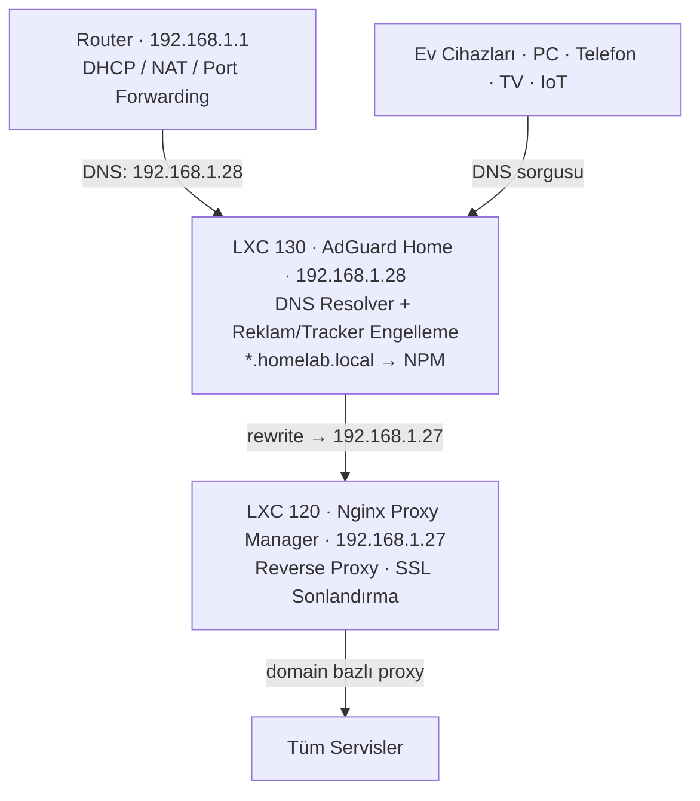

### AdGuard Home (LXC 130)

Tüm ağın DNS sunucusu — her cihaz DNS için buraya bakıyor.

- **Reklam/tracker engelleme:** Ağ genelinde, cihaz başına kurulum gerektirmez
- **DNS rewrite:** `*.homelab.local` → `192.168.1.27` (NPM). Yeni servis = yeni rewrite kaydı
- **Özel filtre kuralları:** Kategori veya domain bazlı engelleme
- **MCP ile yönetim:** `adguard_add_rewrite`, `adguard_set_custom_rules`, `adguard_set_protection`

### Nginx Proxy Manager (LXC 120)

Tüm servislerin ön kapısı. SSL sertifikaları burada sonlandırılıyor.

Aktif proxy kuralları (canlı veriden):

| Domain | Hedef | Port |
|--------|-------|------|
| `git.homelab.local` | 192.168.1.25 | 80 |
| `svn.homelab.local` | 192.168.1.26 | 13081 |
| `n8n.homelab.local` | 192.168.1.141 | 5678 |
| `hermes.homelab.local` | 192.168.1.80 | 9119 |
| `adguard.homelab.local` | 192.168.1.28 | 3000 |
| `npm.homelab.local` | 192.168.1.27 | 81 |
| `mcp.homelab.local` | 192.168.1.60 | 8000 |
| `pv.homelab.local` | 192.168.1.123 | 8006 |

---

## Kontrol Düzlemi: ProxmoxMCP (LXC 160)

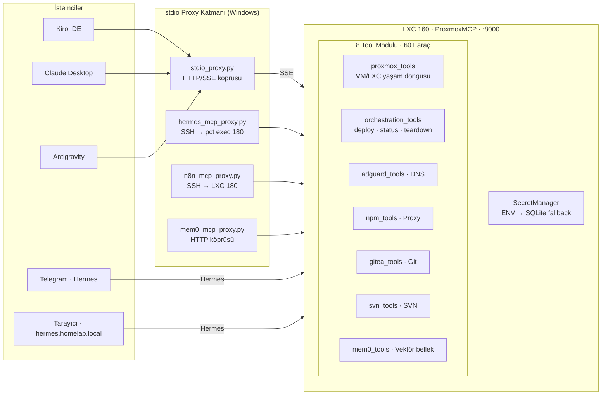

**Bootstrap (46 satır, `main.py`):**
```python
sm     = SecretManager()                          # ENV öncelikli, SQLite fallback
client = ProxmoxClient(sm)                        # proxmoxer API + SSH sarmalayıcı
ag     = AdGuardManager(sm)
npm    = NPMManager(sm)
gitea  = GiteaManager(sm)
svn    = SVNManager(sm, exec_fn=client.exec_in_lxc)

mcp = FastMCP("HomeLab-Proxmox-MCP")
register_all(mcp, pve, client, ag, npm, gitea, svn)
```

---

## MCP Araç Kataloğu

### Proxmox VM/LXC Yönetimi

| Araç | İşlev |
|------|-------|
| `list_resources` | Tüm VM/LXC — durum ve tag'lerle |
| `get_resource_details` | Detaylı config + runtime stats |
| `manage_power` | start / stop / shutdown / reboot |
| `create_lxc` | Yeni Ubuntu 24.04 LXC (RAM, disk, IP ayarlanabilir) |
| `remove_resource` | Kalıcı silme |
| `clone_resource` | Tam veya linked clone (donor → worker akışı) |
| `create_snapshot` / `list_snapshots` | Snapshot yaşam döngüsü |
| `backup_resource` | vzdump ile depolamaya yedek |
| `set_tags` | Kaynak etiketleme (`scraper;worker`, `infra;shadow`) |
| `get_node_stats` | Canlı CPU / RAM kullanımı |
| `get_storage_info` | ZFS pool + dir kullanım durumu |
| `exec_in_container` | LXC içinde kabuk komutu (`pct exec` üzerinden) |

### Çapraz Servis Orkestrasyon

```
deploy_service(vmid=170, name="yeni-bot", ip="192.168.1.70",
               domain="yeni-bot.homelab.local", forward_port=8080)

→ [OK] LXC 170 oluşturuldu (192.168.1.70)
→ [OK] DNS: yeni-bot.homelab.local → 192.168.1.27
→ [OK] NPM: yeni-bot.homelab.local → 192.168.1.70:8080
```

| Araç | İşlev |
|------|-------|
| `infra_status` | Tüm servisler için PVE durumu + HTTP probe |
| `deploy_service` | LXC oluştur + DNS rewrite + NPM proxy (atomik) |
| `destroy_service` | Durdur + sil + DNS kaldır + NPM kaldır (atomik teardown) |
| `register_service_domain` | Var olan LXC'ye domain ekle |

### DNS (AdGuard), Proxy (NPM), Git (Gitea), SVN

Her domain için tam CRUD araçları mevcut — liste, ekle, sil, güncelle.

### Semantik Bellek (Mem0 + pgvector)

LXC 141'de çalışan PostgreSQL 17 + pgvector + Gemini embedding motoru.

| Araç | İşlev |
|------|-------|
| `mem0_search` | Vektör benzerlik araması, kullanıcı kapsamlı |
| `mem0_add` | Bellek kaydet (kategori + ajan metadata) |
| `mem0_list_recent` | Son bellekler |
| `mem0_delete` | ID ile sil |

AI ajanları oturumlar arası bağlam burada saklar — sonraki oturumda geri çağırır.

---

## Hermes: Altyapının Ses Kumandalı Kontrolü

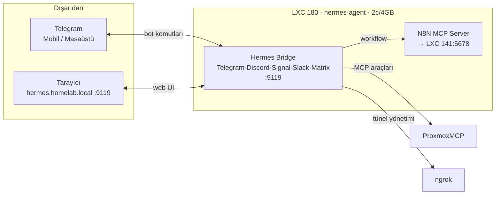

Telegram veya tarayıcıdan yapılabilecekler:
- İstediğim VM/LXC'yi başlatıp durdurmak
- Yeni servis deploy etmek
- Health check çalıştırmak
- N8N workflow tetiklemek
- Gitea reposunda AI ajana değişiklik yaptırmak
- **Herhangi bir VM'e ngrok VNC tüneli açmak**

---

## Ngrok + VNC: Her Yerden VM Erişimi

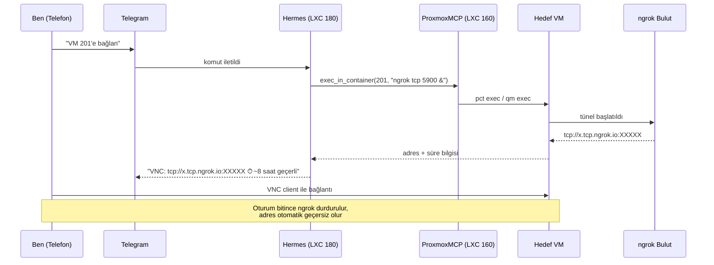

Her tünel oturumu sınırlı süreli ve her açılışta adres değişiyor — kalıcı port açık bırakmaktan çok daha güvenli. Sadece o Telegram mesajını alan kişi adresi bilir, süre dolunca bağlantı kendiliğinden kesilir.

---

## Donor VM Sistemi

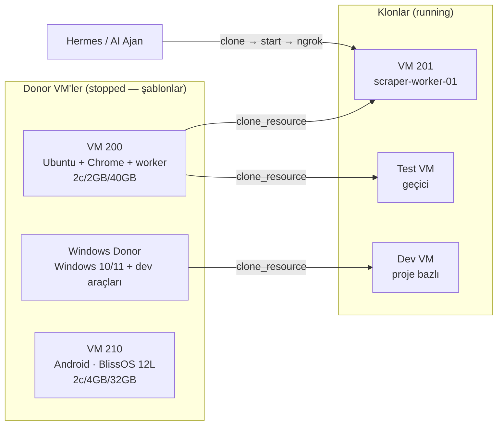

**Akış:**
1. Telegram / Kiro: *"Yeni scraper worker lazım"*
2. `clone_resource(200, 202)` → `manage_power(202, "start")`
3. VM hazır, ngrok tüneli açılır, VNC adresi Telegram'a düşer
4. İş bitince: `remove_resource(202)` — iz kalmaz

---

## Telegram Bildirimleri

N8N workflow'larının son adımı çoğunlukla Hermes üzerinden bir Telegram mesajı:

| Senaryo | Tetikleyici |
|---------|------------|
| Sabah altyapı raporu | Günlük cron → `infra_status` → Hermes |
| Servis çöküşü | HTTP probe başarısız → Hermes |
| İzleme botu sonucu | Sayfa değişikliği tespit edildi → Hermes |
| İşlem tamamlandı | Clone / backup / deploy → Hermes |
| 3. parti uygulama güncellemesi | N8N cron → `exec_in_container` → paket kontrolü → Hermes |
| Dış API tetikleyicisi | RSS feed / webhook / ping başarısız → Hermes |

### 3. Parti Uygulama Güncelleme Takibi

Proxmox içine elle kurduğum uygulamalar var — Gitea, AdGuard, N8N, özel araçlar. Bunların yeni sürümü çıktığında hiçbir yerde otomatik bildirim gelmiyor. Bunu çözmek için Hermes'e tek bir Türkçe komut yeterli:

> *"Gitea ve AdGuard için güncelleme kontrolü yap, güncelleme varsa bildir, her sabah 08:00'de otomatik kontrol için de cron kur"*

Hermes bunu şu adımlara dönüştürüyor:

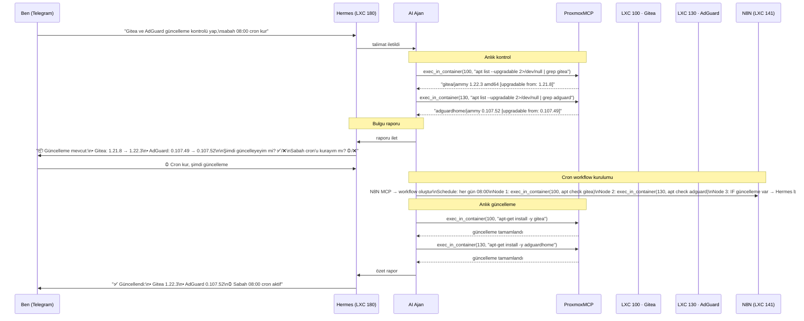

Sabah 08:00'den itibaren her gün bu workflow çalışır. Güncelleme yoksa sessiz kalır. Güncelleme çıktığında Telegram'a düşer — o zaman güncelleme kararını veririm.

**Bu yaklaşım herhangi bir servis için genişler:** Docker image güncellemeleri (`docker pull` + yeni digest kontrolü), Python paket güncellemeleri (`pip list --outdated`), npm/node paketleri, özel binary'ler için GitHub Releases API sorgusu — hepsi `exec_in_container` + N8N + Hermes zinciriyle aynı pattern.

---

## LXC 141: Docker Host

```
LXC 141 — docker-host-default (192.168.1.141)
4 core / 4 GB RAM / 20 GB ZFS
unprivileged + nesting=1 + keyctl=1 + fuse=1
│
├── n8n             (n8nio/n8n:latest)       :5678   Workflow otomasyon motoru
├── mem0-server     (mem0-mem0)               :8888   Semantik vektör bellek API
├── mem0-postgres   (pgvector/pgvector:pg17)          PostgreSQL 17 + pgvector
├── 9router         (9router-custom)                   AI gateway — 40+ sağlayıcı
└── watchtower      (containrrr/watchtower)            Docker image otomatik güncelleme
```

`nesting=1 + fuse=1 + keyctl=1` kombinasyonu Docker-in-LXC'nin Proxmox'ta güvenilir çalışması için zorunlu.

**Watchtower** burada özellikle dikkat çekici — Docker image'larını periyodik kontrol edip yeni sürüm çıkınca container'ı otomatik güncelliyor. Docker'a dayanan servisler için güncelleme takibi sorunu büyük ölçüde kendiliğinden çözülmüş. APT ile kurulan servisler (Gitea, AdGuard) hâlâ `exec_in_container` + N8N cron yöntemini gerektiriyor.

---

## İzleme Botu Akışı

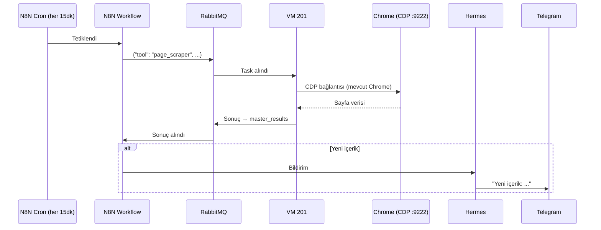

Mevcut bir Chrome oturumuna Chrome DevTools Protocol üzerinden bağlanmak, otomasyonu sıradan tarayıcı kullanımından ayırt edilemez kılar — Playwright ve Puppeteer'ın da kullandığı standart yaklaşım.

---

## Taşınabilirlik ve Sıfır PC Kurulumu

### Sorun

Kişisel geliştirme ortamları genellikle taşınamaz hale gelir. Hardcoded path'ler, makine başına dağılmış konfigürasyonlar, "bu sadece bende çalışır" durumu. Bir gün PC değiştiğinde ya da disk bozulduğunda yeniden kurmak saatler, bazen günler sürer.

Bu sorunu kabul etmeyerek MyEnv'i başından sona taşınabilirlik ilkesiyle tasarladım.

### MyEnv Mimarisi: Beyin + Beden

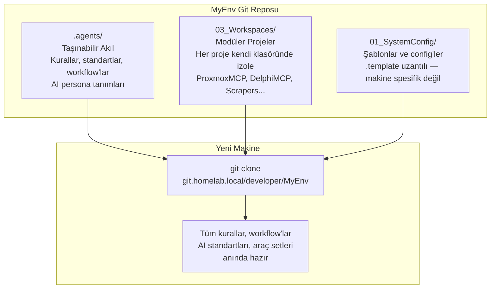

**`.agents/` klasörü taşınabilir akıldır.** İçinde:
- AI davranış standartları ve persona tanımları (Delphi profili, genel profil, infra profili)
- Proje yönetimi kuralları
- Workflow tanımları (delphi-compile, delphi-write, scraper-run, infra-deploy...)
- Encoding standartları
- Anti-pattern listesi ve best practice'ler

Bu klasörü yeni bir makineye kopyaladığında Kiro, Claude veya Antigravity aynı "MyEnv aklıyla" çalışmaya devam eder — hiçbir şeyi yeniden anlatmak gerekmez.

### Taşınabilirlik Kuralları

**Absolute path yasağı.** Hiçbir script, konfigürasyon veya kod dosyasında sabit sürücü yolu yok:

```powershell
# YASAK
$path = "D:\MyEnv\03_Workspaces\..."

# ZORUNLU
$path = Join-Path $PSScriptRoot "..\03_Workspaces\..."
# veya
$path = Join-Path $env:USERPROFILE "MyEnv\..."
```

**`.template` dosyaları.** Makine özgü konfigürasyonlar (IDE ayarları, MCP bağlantı bilgileri) `.template` uzantısıyla depoda tutulur. Yeni makinede template kopyalanıp makineye özel değerler girilir — repo temiz kalır.

**Git `autocrlf` aktif.** Windows odaklı yapı olduğu için CRLF uyumluluğu Git seviyesinde korunur.

### Hafıza Kaybı Olmadan Taşınma

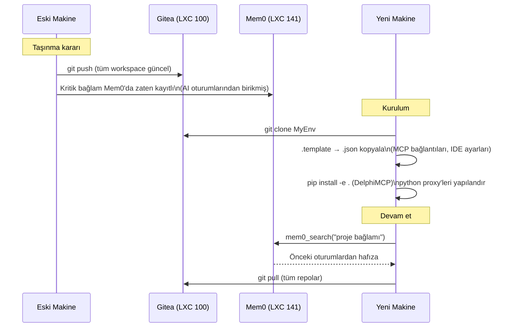

Proxmox sunucusu tamamen ayrı duruyor — servisler orada çalışmaya devam eder. Sadece Windows iş istasyonu değişiyor. Gitea'dan repo çekilip template'ler yapılandırılınca **aynı yer kaldığından devam edilebilir**.

Daha da ileri giderse: Mem0 oturumlar arası hafızayı saklıyor, AI ajanı önceki konuşmalardan öğrendiklerini bu vektör veritabanından geri çağırır. PC değişse de "şu projede şu kararı almıştık" bilgisi kaybolmaz.

---

## Merkezi Secret Yönetimi

### Sorun

Farklı servislerin credentials'larını farklı yerlerde tutmak kaosa yol açar: Docker `env` dosyaları, LXC içindeki `.env` dosyaları, Windows tarafındaki proxy script'leri, Proxmox API token'ları... Hepsi ayrı yerde, hepsi ayrı format.

### Çözüm: Tek Merkez, Katmanlı Erişim

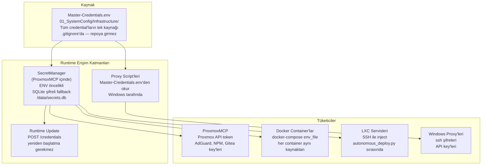

**`Master-Credentials.env`** tek gerçek kaynak. Format basit:

```
PVE_HOST=192.168.1.123
PVE_USER=root@pam
PVE_PASS=...
ADGUARD_URL=http://192.168.1.28:3000
ADGUARD_PASS=...
GITEA_TOKEN=...
N8N_API_KEY=...
MEM0_API_KEY=...
```

Bu dosya `.gitignore`'da — repoya asla girmez. Yeni makinede `Master-Credentials.env.template` kopyalanıp değerler doldurulur.

**SecretManager** uygulama başlangıcında bu dosyayı okur. ENV değişkeni varsa onu, yoksa SQLite veritabanındaki şifreli değeri kullanır. Değer runtime'da güncellenmek istenirse:

```bash
curl -X POST http://192.168.1.60:8000/credentials \
  -d '{"key": "PVE_PASS", "value": "yeni_sifre"}'
```

Servis yeniden başlamadan yeni değer aktif olur.

### Farklı Katmanlarda Kullanım

| Katman | Nasıl alıyor | Nerede kullanıyor |
|--------|-------------|-------------------|
| ProxmoxMCP | `SecretManager` → ENV/SQLite | Proxmox API, AdGuard, NPM, Gitea |
| Docker container'lar | `docker-compose env_file` | Her container kendi ihtiyacını alır |
| LXC servisleri | `autonomous_deploy.py` SSH inject | Deploy sırasında container'a yazılır |
| Windows proxy'leri | Dosyadan doğrudan okuma | SSH şifreleri, API key'leri |
| DelphiMCP | Aynı pattern | Build araçları, repo erişimi |

Takım ortamında veya prodüksiyon ihtiyacında bu katman HashiCorp Vault, Infisical veya benzeri açık kaynak bir vault çözümüyle değiştirilebilir — `SecretManager`'ın okuma kaynağı değişir, uygulama kodu değişmez.

---

## Veri Güvenliği ve Yedekleme

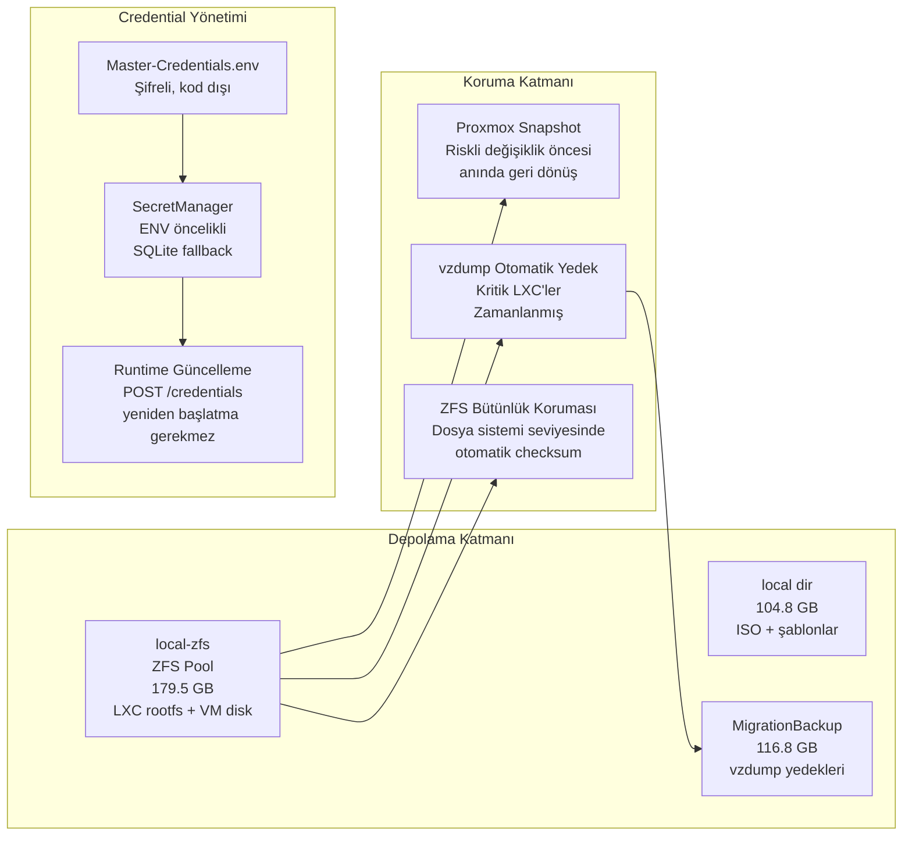

**ZFS:** Tüm LXC ve VM diskleri ZFS pool üzerinde. Dosya sistemi seviyesinde checksum koruması — sessiz veri bozulması (bit rot) ZFS tarafından tespit edilir ve onarılır.

**vzdump yedekleri:** Kritik LXC'lerin otomatik zamanlanmış yedekleri `MigrationBackup` alanına yazılıyor. Yedek var olduğu sürece herhangi bir LXC önceki haline döndürülebilir.

**Snapshot:** Riskli bir değişiklikten (büyük güncelleme, config değişikliği) önce anlık snapshot. Bir şeyler ters giderse tek tıkla geri dön.

**Credential mimarisi:** Hiçbir credential uygulama kodunda değil. `SecretManager` başlangıçta `Master-Credentials.env`'den yükler (ENV öncelikli), SQLite tabanlı şifreli fallback ile çalışır. Runtime'da yeniden başlatmaya gerek kalmadan güncelleme:

```bash
curl -X POST http://192.168.1.60:8000/credentials \
  -H "Content-Type: application/json" \
  -d '{"key": "PVE_PASS", "value": "yeni_sifre"}'
```

Takım ortamında bu katman HashiCorp Vault, Infisical gibi açık kaynaklı vault çözümleriyle değiştirilebilir — uygulama kodu değişmez, sadece `SecretManager`'ın okuma kaynağı değişir.

---

## Windows → Proxmox: stdio Proxy Köprüsü

AI istemcileri Windows'ta MCP stdio üzerinden çalışır. Proxmox servisleri SSE/HTTP üzerinden MCP sunar. Dört Python proxy bu boşluğu kapatır:

```
Windows
├── stdio_proxy.py      ──HTTP/SSE──► ProxmoxMCP :8000/sse
│     MCP el sıkışmasını (handshake) proxy üzerinden yönetir.
│     server/discover → -32601 (capability cache, SSE köprüsü)
│
├── hermes_mcp_proxy.py ──SSH──► Proxmox host ──pct exec 180──► hermes mcp serve
│
├── n8n_mcp_proxy.py    ──SSH──► LXC 180 ──► N8N MCP server
│
└── mem0_mcp_proxy.py   ──HTTP──► Mem0 API :8888
```

`stdio_proxy.py`'deki protokol detayı: MCP istemcisi `server/discover` gönderdiğinde (eski SSE sunucusunun desteklemediği yeni bir özellik), proxy `-32601 Method not found` ile yanıt verir — istemci timeout beklemeden standart `initialize` handshake'e geçer. Bu tür edge case'ler resmi dokümanlarda yer almaz; ham JSON-RPC trafik analizinden çözüldü.

---

## Docker ve LXC Araçları: Proxmox'tan İçeriye Doğrudan Erişim

ProxmoxMCP sadece LXC seviyesinde değil, LXC içindeki Docker container'larına da MCP araçları üzerinden doğrudan ulaşabiliyor. Bir LXC'ye SSH açmaya ya da ayrı bir Docker yönetim paneline gerek kalmıyor.

### Docker Araç Kataloğu

| Araç | İşlev |
|------|-------|
| `docker_ps(vmid)` | LXC içindeki tüm container'ları listele (isim, image, durum, port) |
| `docker_images(vmid)` | Mevcut Docker image'larını listele |
| `docker_start/stop/restart(vmid, container)` | Container yaşam döngüsü |
| `docker_remove(vmid, container)` | Container sil |
| `docker_logs(vmid, container, tail)` | Container log çıktısı |
| `docker_inspect(vmid, container)` | Env, mount, network detayı |
| `docker_stats(vmid)` | Tüm container'ların anlık CPU/RAM kullanımı |
| `docker_exec(vmid, container, command)` | Container içinde komut çalıştır |
| `docker_pull(vmid, image)` | Image çek |
| `docker_compose_up(vmid, compose_dir)` | `docker compose up -d` çalıştır |
| `docker_compose_down(vmid, compose_dir)` | `docker compose down` çalıştır |
| `docker_compose_logs(vmid, compose_dir)` | Compose proje logları |
| `write_file_to_lxc(vmid, remote_path, content_b64)` | Herhangi bir LXC'ye dosya yaz (base64 encode ile) |
| `deploy_to_lxc(vmid, local_path, remote_path)` | Proxmox host üzerinden LXC'ye dosya kopyala |
| `mcp_deploy_file(local_path, remote_path)` | Proxmox host'tan ProxmoxMCP LXC'sine deploy et + container yeniden başlat |

### Erişim Katmanları: LXC'den Docker'a Kadar

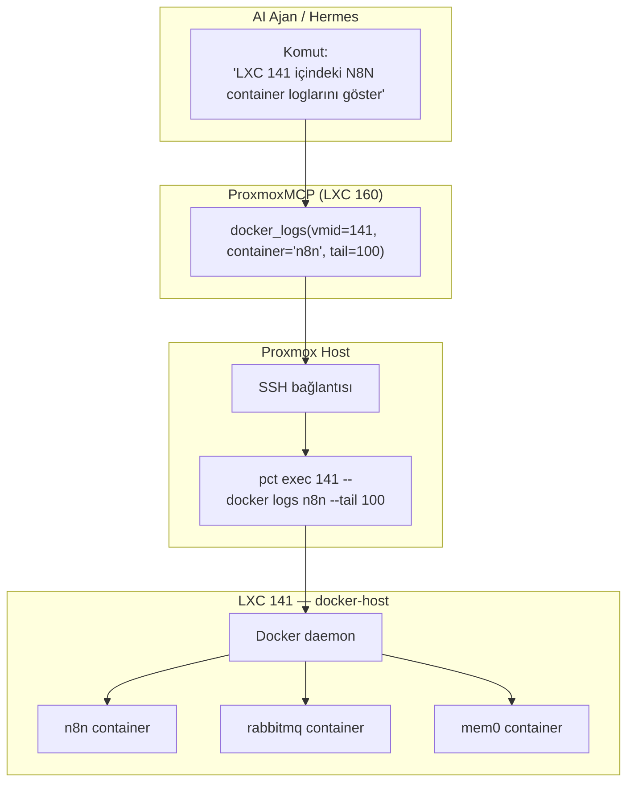

Bu zincir her Docker komutu için aynı şekilde çalışıyor: AI ajan MCP aracını çağırıyor → ProxmoxMCP SSH ile Proxmox host'a bağlanıyor → `pct exec` ile LXC içinde komutu çalıştırıyor → sonuç geri dönüyor. Herhangi bir intermediate panel yok.

### Dosya Transfer ve Deploy

`write_file_to_lxc` ile herhangi bir içeriği base64 encode ederek doğrudan bir LXC dosya sistemine yazabiliyorum. `mcp_deploy_file` ise ProxmoxMCP'nin kendi container'ını güncellemeye özel: yeni bir araç dosyası yazıp container'ı yeniden başlatmak tek çağrı.

Örnek kullanım — ProxmoxMCP'ye yeni bir araç eklemek:

```
1. AI ajan yeni tool.py dosyasını üretir
2. write_file_to_lxc(160, "/tmp/new_tool.py", content_b64) ile Proxmox host'a yükle
3. mcp_deploy_file("/tmp/new_tool.py", "/opt/proxmox-mcp/tools/new_tool.py", restart=True)
4. ProxmoxMCP container yeniden başlar, yeni araç kullanılabilir
```

---

## MCP Katmanları ve Entegrasyon

Bu altyapıda birden fazla MCP sunucu bir arada çalışıyor ve birbirlerini tamamlıyor. Her biri farklı bir problemi çözmek için ortaya çıktı; birlikte tek bir kontrol düzlemini oluşturuyorlar.

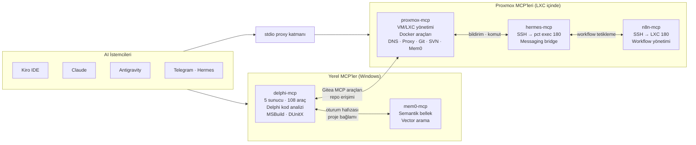

### Hangi MCP Ne Zaman Devreye Giriyor

**Delphi geliştirme senaryosu:**
1. `delphi-mcp-intel` — kaynak kodu analiz et, blast radius hesapla
2. `delphi-mcp-action` — güvenli refactoring uygula
3. `proxmox-mcp (gitea_tools)` — Gitea'ya commit at
4. `hermes-mcp` → `n8n-mcp` — CI/CD workflow tetikle
5. `proxmox-mcp (docker_tools)` — test container'ı başlat, derleme çalıştır
6. `hermes-mcp` — sonucu Telegram'a ilet

**Altyapı güncelleme senaryosu:**
1. `proxmox-mcp (docker_tools)` → `docker_ps(141)` — hangi container'lar var?
2. `proxmox-mcp (exec_in_container)` — `apt list --upgradable` ile güncelleme kontrol
3. `n8n-mcp` — günlük kontrol workflow'u oluştur
4. `hermes-mcp` — güncelleme bildirimi Telegram'a

**Yeni servis deploy senaryosu:**
1. `proxmox-mcp (create_lxc)` — yeni LXC
2. `proxmox-mcp (write_file_to_lxc)` — docker-compose.yml yaz
3. `proxmox-mcp (docker_compose_up)` — servisi başlat
4. `proxmox-mcp (orchestration)` → `deploy_service` — DNS + NPM proxy otomatik

Her MCP kendi alanında uzman; AI ajan ihtiyaca göre hangisine gideceğine karar veriyor. Gerçekte bazı entegrasyonlar hâlâ geliştirilme aşamasında — ama mimari bu yönde kurgulandı ve araçlar bu akışı destekliyor.

**LXC 100 — 192.168.1.25 — 1c/1GB/30GB**

Kişisel projeler, henüz GitHub'a gönderilmemiş çalışmalar ve kurumsal araçlar burada. Yerel ağdan `git.homelab.local`, dışarıdan Hermes tüneli üzerinden erişim.

Güçlü tarafı: AI ajan entegrasyonu. Telefon başındayken Hermes üzerinden ajana talimat verip bir repoda branch açtırabilir, commit yaptırabilir, webhook tetikletebilirim. Klonlanan bir test VM'inde sonucu görebiliyorum — PC başında olmak zorunlu değil.

MCP araçları: `gitea_create_repo`, `gitea_list_repos`, `gitea_create_branch`, `gitea_list_branches`, `gitea_create_issue`, `gitea_add_webhook`.

---

## Tam Sistem Şeması

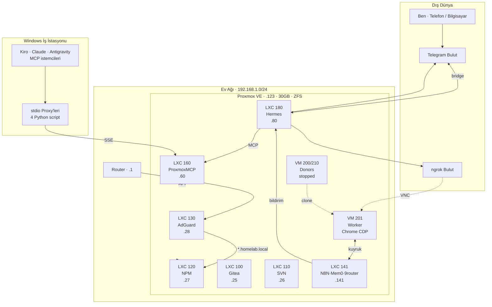

---

## DelphiMCP: AI Editör Çıkmazlarına Delphi Özgün Çözüm

### Neden Geliştirildi?

AI kod editörleri (Kiro, Claude, Cursor vb.) Delphi ile çalışırken ciddi kör noktalara sahip. `.pas` ve `.dfm` dosyaları düz metin olarak okunuyor; Delphi'nin bileşen modeli, `uses` zinciri, interface/implementation senkronizasyonu veya UTF-8 BOM + CRLF zorunluluğu anlaşılamıyor. Sonuç: editör kod yazıyor ama ürettiği değişiklikler sessizce derlenme hataları yaratıyor, Türkçe karakterler bozuluyor veya DFM/PAS desenkronizasyonu oluşuyor.

DelphiMCP bu soruna yönelik, sıfırdan yazılmış bir MCP sunucu — 5 özelleşmiş sunucu, 108 araç, Delphi kaynak kodunu düz metin değil **yapılandırılmış veri** olarak yorumlayan bir parsing motoru.

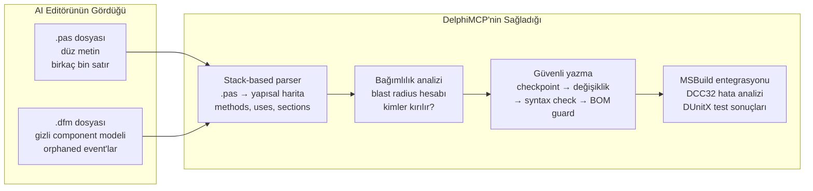

### Mimari: 5 Sunucu, 108 Araç

```
delphi-mcp-master   Orkestrasyon — pipeline, hook, rule, persona, checkpoint
delphi-mcp-intel    Analiz/okuma — pas_*, dfm_*, proj_*, search_*
delphi-mcp-action   Refactoring/yazma — refactor_*, scaffold_*
delphi-mcp-quality  Kalite/QA — quality_*, encoding, BOM, syntax
delphi-mcp-ops      OPS — telemetry, session, profile, runbook
```

Her araç `(JSON girdi) → işlem → (JSON çıktı)` döngüsünde çalışır — session state tutmaz. Her çağrı `logs/mcp_outputs/<tool>_<trace_id>.json` olarak arşivlenir.

### Temel Özellikler ve Neden Önemli

**Encoding otomatik koruması**
Delphi'de her `.pas` ve `.dfm` UTF-8 BOM + CRLF ile kaydedilmek zorunda — en azından Türkçe karakter içeren projelerde bu benim çözdüğüm yol bu. Delphi tarihsel olarak Windows-1254 (ANSI Türkçe) ile çalışırdı; modern IDE'ler UTF-8 destekliyor ama BOM olmadan kaydedilen bir dosyada Türkçe karakterler sessizce bozulabiliyor. Bu zorunluluğu kural olarak kodlayıp tüm araçlara otomatik kontrol ekledim — daha iyi ya da farklı bir yaklaşım olabilir, ama bu sorunla yaşamayı bıraktım. Her yazma aracı işlem sonrası otomatik BOM kontrolü yapar; eksiklik varsa yanıtta `_bom_warning` ile uyarır ve `quality_fix_encodings` önerir.

> Bu konunun daha geniş arka planı için bkz. [Delphi Encoding Geçmişi](#delphi-encoding-geçmişi-iki-yıllık-bir-problem) bölümü.

**Stack-based parser — regex yasağı**
Delphi kaynak kodunu parse etmek için saf regex kullanmak yasak (Altın Kural #5). Araçların kendi parser'ı — `begin..end` iç içe geçmesi, `uses` zinciri, conditional define blokları gibi yapıları doğru işler.

**Blast radius analizi — önce etki ölç**
Herhangi bir değişiklikten önce `proj_find_dependents` ile kaç unit etkileneceği hesaplanır. Sembol değiştirmeden, parametre eklemeden, rename yapmadan önce kırılacak noktalar bilinir.

**Güvenli uygulama pipeline'ı**
`refactor_safe_apply_orchestrator` tek çağrıda şunları yapar:
1. Bağımlılık analizi (blast radius)
2. Checkpoint (geri dönüş noktası)
3. Değişiklikleri uygula
4. Syntax kontrolü
5. BOM + encoding doğrulaması
6. Pre-commit guard

**Windows Registry'den IDE keşfi**
MSBuild path ve Delphi IDE kurulumu Windows Registry'den otomatik tespit edilir — hardcoded path yok, herhangi bir Delphi sürümüyle çalışır.

**Hook ve kural motoru**
Proje başına `.delphi_mcp/hooks.json` ve `rules.json` tanımlanabiliyor:

```json
{
  "hooks": {
    "post_rename":  ["quality_check_syntax", "build_run_tests"],
    "post_bugfix":  ["build_run_tests", "workflow_pre_commit_guard"],
    "on_failure":   ["checkpoint_list"]
  },
  "rules": [
    {"id": "utf8-enforce", "tool": "quality_fix_encodings", "trigger": "post_commit", "severity": "error"},
    {"id": "no-sql-concat","tool": "quality_fix_sql_concat", "trigger": "post_operation", "severity": "warn"}
  ]
}
```

### Seçili Araçlar

| Katman | Araç | Ne Yapar |
|--------|------|----------|
| L2 Okuma | `pas_analyze_unit_full` | Tüm unit raporu: üyeler, uses, section'lar |
| L2 Okuma | `dfm_read_events` | DFM event→method eşleşmeleri (static + runtime) |
| L2 Okuma | `dfm_read_all_sql` | Form içindeki tüm gömülü SQL sorguları |
| L3 Etki | `proj_find_usages` | Sembolün proje genelindeki tüm kullanımları |
| L3 Etki | `proj_extract_call_graph` | Bir metoddan başlayan çağrı akışı |
| L3 Etki | `dfm_sync_pas_declarations` | DFM'deki tüm component'lar PAS'ta tanımlı mı? |
| L4 Yazma | `refactor_rename_symbol` | Güvenli proje geneli rename (.pas + .dfm) |
| L4 Yazma | `refactor_add_parameter` | Parametreye ekle + tüm call-site güncellemesi |
| L4 Yazma | `quality_fix_empty_except` | Boş except bloklarını loglayan şablonla doldur |
| L4 Yazma | `quality_fix_encodings` | Toplu UTF-8 BOM + CRLF uygulama |
| L5 Ork. | `build_run_msbuild` | MSBuild ile derleme, JSON hata/uyarı analizi |
| L5 Ork. | `workflow_pre_commit_guard` | Commit öncesi kalite kapısı |
| L5 Ork. | `checkpoint_create/restore` | Değişiklik öncesi snapshot, tek komutla geri dön |
| L5 Ork. | `report_code_health` | Proje sağlık skoru (0-100) + grade (A-D) |

### Bu Herhangi Bir Stack İçin Yapılabilir

DelphiMCP, Delphi'ye özgü sorunları çözmek için yazıldı — ama mimari evrensel:

- **Dile özgü parser** → herhangi bir dilin AST/yapısal analizi
- **Encoding guard** → herhangi bir karakter seti zorlaması
- **Blast radius analizi** → herhangi bir bağımlılık grafı
- **Safe apply orchestrator** → herhangi bir "analiz → checkpoint → uygula → doğrula" döngüsü

Python projesi, TypeScript/JavaScript projesi veya herhangi başka bir dil için aynı MCP pattern uygulanabilir. Delphi bu altyapının ilk gerçek kullanım alanı oldu.

---

## Telegram Onaylı Kod Değişikliği Senaryosu

Evde olmadan, telefondan kod değişikliği yapıp test etmek:

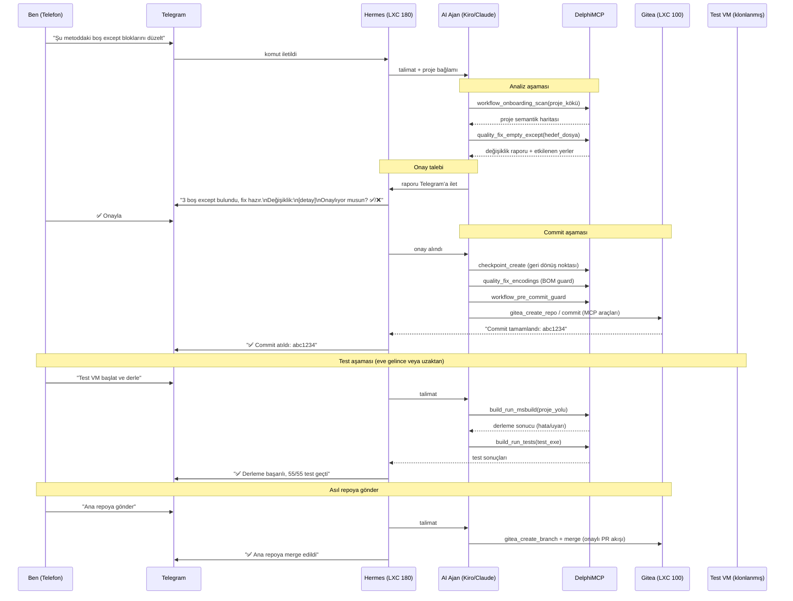

**Bu senaryonun gerçek değeri:**

Evden çıkarken aklıma takılan bir kod problemi var. Telefona bakıyorum, Telegram'dan AI ajana görevi iletiyorum. Ajan analiz yapıyor — hangi dosyalar etkilenecek, ne değişecek — ve bana özet raporu gönderiyor. Ben onaylıyorum, ajan commit atıyor. Eve geldiğimde tek yapılacak: test ortamında derleyip testleri çalıştırmak. İşin büyük kısmı bitmişti bile.

Onay mekanizması kritik: ajan analiz yapıp "şunları değiştireceğim" diye sormadan tek başına commit atmıyor. Kodu görmeden, anlamadan kör bir şekilde değişiklik yapılmıyor.

---

## Bu Yapının Hizmet Edebileceği Alanlar

| Alan | Bu altyapının karşılığı |
|------|------------------------|
| Geliştirme altyapısı | Self-hosted Git + zamanlanmış staging ortamları, dakikalar içinde izole test VM'i |
| Otomasyon ve izleme | N8N + RabbitMQ + Hermes — prodüksiyon kalitesinde async workflow |
| AI destekli yönetim | MCP üzerinden insan müdahalesi olmadan LXC provisioning, DNS, proxy, health check |
| Uzaktan erişim | Donor klonu + ngrok VNC — geçici izole masaüstü, iş bitince silinir |
| Ağ güvenliği | AdGuard + NPM — LAN genelinde içerik filtreleme, SSL sonlandırma |
| Veri güvenliği | ZFS bütünlüğü + vzdump yedek + snapshot + vault benzeri credential yönetimi |

---

---

## Delphi Encoding Geçmişi: İki Yıllık Bir Problem

Bu konu tek bir araçla bitmedi. İki yılı aşkın sürede, farklı Delphi versiyonlarında, farklı bilgisayarlarda, farklı editörlerle defalarca aynı sorunla karşılaştım — ve her seferinde biraz daha derine inip daha sağlam bir çözüm geliştirdim.

### Sorunun Kökü

Delphi'nin Türkçe karakter sorunu aslında birkaç farklı katmanın üst üste binmesiyle oluşuyor:

```
Kaynak dosyanın disk üzerindeki encoding
      ↓
Delphi IDE'nin dosyayı nasıl okuduğu
      ↓
Derleyicinin (DCC32) string literal'ları nasıl yorumladığı
      ↓
Runtime'da ekranda/veritabanında ne görüntülendiği
```

Her katman ayrı davranabiliyor. Dosya UTF-8 BOM ile kaydedilmiş olabilir ama Delphi 2010 onu ANSI okuyabilir. Ya da IDE'de doğru görünür ama derlenince bozulur.

### Yaşanan Sorun Tipleri

**ANSI → UTF-8 geçiş karmaşası**
Eski Delphi 2010 projeleri Windows-1254 (ANSI Türkçe) ile yazılmıştı. Modern Delphi'ye (`D11`, `D12`) taşırken dosyalar UTF-8'e dönüştürülüyor ama BOM eklenmezse ya da dönüşüm doğru yapılmazsa `ş` → `Å`, `ğ` → `ı` gibi bozulmalar oluşuyor. Her dosyanın ayrı ayrı elle kontrol edilmesi saatler sürüyordu.

**AI editör müdahaleleri**
AI kod editörleri dosya yazdığında encoding'e dikkat etmiyor. Kiro ya da Claude bir `.pas` dosyasına yazdığında BOM'u koruyup korumadığı belirsiz — bazen koruyor, bazen UTF-8 BOM olmadan yazıyor, bazen satır sonlarını LF'ye çeviriyor. Her müdahaleden sonra Türkçe karakterler test edilmek zorunda kalıyordu.

**Kaynak kontrol geçişleri**
Git, SVN veya başka bir araç üzerinden dosya alındığında encoding metadata'sı korunmayabiliyor. Özellikle Windows–Linux arası operasyonlarda CRLF→LF dönüşümü `.pas` dosyalarını Delphi IDE'sinde yavaş açtırıyor ya da karakter bozulmalarına yol açıyordu.

**Char escaping çözümü**
Bazı kritik yerlerde encoding güvenilemeyince Türkçe karakterleri doğrudan karakter kodlarıyla yazmak (`#351` = ş, `#305` = ı gibi) gerekti. Kalıcı çözüm değil ama o sırada tek güvenilir yol buydu.

### Bulduğum Yaklaşım

Sorunun her seferinde tekrarlanmaması için "encoding doğrulama" adımını geliştirme akışının içine gömdüm:

1. **Proje geneli BOM kontrolü** — `quality_check_bom` aracı tüm `.pas/.dfm/.dpr/.inc` dosyalarını tarar, BOM eksik olanları listeler
2. **Toplu düzeltme** — `quality_fix_encodings` hepsini UTF-8 BOM + CRLF'e dönüştürür
3. **AI yazma sonrası otomatik kontrol** — her `refactor_*` veya `quality_fix_*` çağrısından sonra BOM guard otomatik çalışır, eksiklik varsa `_bom_warning` döner
4. **Pre-commit kapısı** — `workflow_pre_commit_guard` commit öncesi encoding kontrolünü zorunlu kılar
5. **Kural motoru** — `.delphi_mcp/rules.json` içinde `utf8-enforce` kuralı post-commit hook olarak çalışır

Bu yaklaşım benim için çalıştı ve sorunu yönetilebilir hale getirdi. Ama Delphi'nin encoding meselesi derindir, versiyona göre davranış değişir, ve bu çözüm bildiğim en iyi yol — en doğru ya da tek yol değil.

> **Not:** Bu notlar 2024-2026 arasındaki tecrübeleri yansıtıyor. Delphi ve AI araçları gelişiyor — daha güncel sürümlerde bazı sorunlar otomatik çözülmüş olabilir.

---

*Cihad Kocaşahan — [github.com/cihadkocasahan](https://github.com/cihadkocasahan) — [linkedin.com/in/cihadkocasahan](https://linkedin.com/in/cihadkocasahan)*
