# Technical Details

← [Back to README](README_EN.md)

This document covers all technical layers of the infrastructure, the MCP tool catalog, data security architecture, and use case walkthroughs.

---

## Physical Infrastructure

```
Proxmox VE — node: pv (192.168.1.123)
├── CPU:     Intel i5 (4 cores)
├── RAM:     30.3 GB
├── Disk:    2x SSD — ZFS mirror (RAID-1)
│            local-zfs  (ZFS pool)   179.5 GB  ← LXC rootfs, VM disks
│            local      (dir)        104.8 GB  ← ISOs, templates
│            MigrationBackup (dir)   116.8 GB  ← vzdump backups
└── Network: vmbr0 bridge — 192.168.1.0/24
```

**ZFS mirror:** Both SSDs hold identical data simultaneously. If one fails, Proxmox keeps running with no data loss. ZFS also provides filesystem-level checksum protection — silent data corruption (bit rot) is automatically detected and repaired.

---

## Home Network Backbone

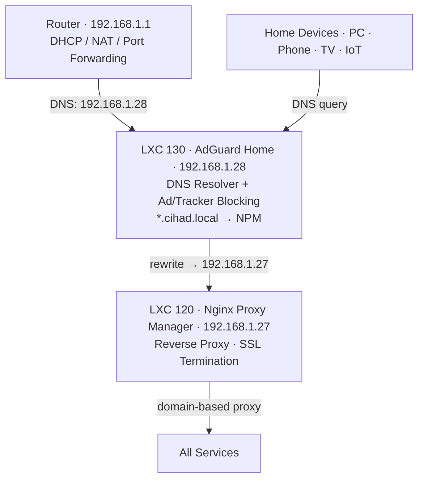

### AdGuard Home (LXC 130)

DNS server for the entire network — every device points here.

- **Ad/tracker blocking:** Network-wide, no per-device setup
- **DNS rewrites:** `*.cihad.local` → `192.168.1.27` (NPM). New service = new rewrite record
- **Custom filter rules:** Category or domain-level blocking
- **MCP management:** `adguard_add_rewrite`, `adguard_set_custom_rules`, `adguard_set_protection`

### Nginx Proxy Manager (LXC 120)

Front door for all services. SSL certificates terminate here.

Active proxy rules (from live data):

| Domain | Target | Port |
|--------|--------|------|
| `git.cihad.local` | 192.168.1.25 | 80 |
| `svn.cihad.local` | 192.168.1.26 | 13081 |
| `n8n.cihad.local` | 192.168.1.141 | 5678 |
| `hermes.cihad.local` | 192.168.1.80 | 9119 |
| `adguard.cihad.local` | 192.168.1.28 | 3000 |
| `npm.cihad.local` | 192.168.1.27 | 81 |
| `mcp.cihad.local` | 192.168.1.60 | 8000 |
| `pv.cihad.local` | 192.168.1.123 | 8006 |

---

## Control Plane: ProxmoxMCP (LXC 160)

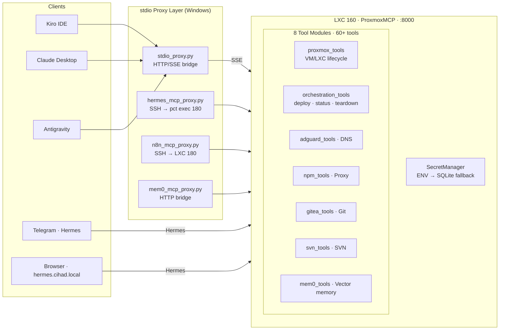

**Bootstrap (46 lines, `main.py`):**
```python
sm     = SecretManager()                          # ENV-first, SQLite fallback
client = ProxmoxClient(sm)                        # proxmoxer API + SSH wrapper
ag     = AdGuardManager(sm)
npm    = NPMManager(sm)
gitea  = GiteaManager(sm)
svn    = SVNManager(sm, exec_fn=client.exec_in_lxc)

mcp = FastMCP("CihadEnv-Proxmox-MCP")
register_all(mcp, pve, client, ag, npm, gitea, svn)
```

---

## MCP Tool Catalog

### Proxmox VM/LXC Management

| Tool | Function |
|------|----------|
| `list_resources` | All VMs/LXCs with status and tags |
| `get_resource_details` | Full config + runtime stats |
| `manage_power` | start / stop / shutdown / reboot |
| `create_lxc` | New Ubuntu 24.04 LXC (RAM, disk, IP configurable) |
| `remove_resource` | Permanent deletion |
| `clone_resource` | Full or linked clone (donor → worker flow) |
| `create_snapshot` / `list_snapshots` | Snapshot lifecycle |
| `backup_resource` | vzdump to storage |
| `set_tags` | Tag resources (`scraper;worker`, `infra;shadow`) |
| `get_node_stats` | Live CPU / RAM |
| `get_storage_info` | ZFS pool + dir usage |
| `exec_in_container` | Shell command inside LXC via `pct exec` |

### Cross-Service Orchestration

```
deploy_service(vmid=170, name="new-bot", ip="192.168.1.70",
               domain="new-bot.cihad.local", forward_port=8080)

→ [OK] LXC 170 created (192.168.1.70)
→ [OK] DNS: new-bot.cihad.local → 192.168.1.27
→ [OK] NPM: new-bot.cihad.local → 192.168.1.70:8080
```

| Tool | Function |
|------|----------|
| `infra_status` | PVE status + HTTP probe for all services |
| `deploy_service` | Create LXC + DNS rewrite + NPM proxy (atomic) |
| `destroy_service` | Stop + delete + remove DNS + remove NPM (atomic teardown) |
| `register_service_domain` | Add domain to existing LXC |

### DNS (AdGuard), Proxy (NPM), Git (Gitea), SVN

Full CRUD tools for each domain — list, add, delete, update.

### Semantic Memory (Mem0 + pgvector)

PostgreSQL 17 + pgvector + Gemini embeddings running in LXC 141.

| Tool | Function |
|------|----------|
| `mem0_search` | Vector similarity search, user-scoped |
| `mem0_add` | Store memory (category + agent metadata) |
| `mem0_list_recent` | Recent memories |
| `mem0_delete` | Delete by ID |

AI agents store cross-session context here — retrieved in the next session.

---

## Hermes: Voice Control for the Infrastructure

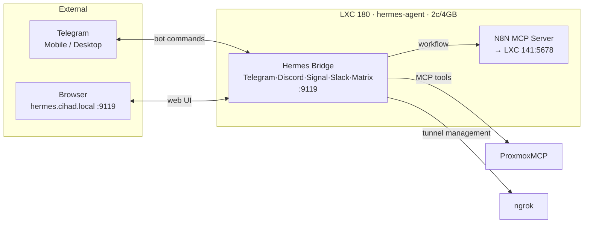

From Telegram or browser:
- Start/stop any VM or LXC
- Deploy a new service
- Run a health check
- Trigger an N8N workflow
- Instruct an AI agent to make changes to a Gitea repo, check the result in a cloned test VM — from the phone, without being at a desk
- **Open an ngrok VNC tunnel to any VM**

---

## Ngrok + VNC: VM Access From Anywhere

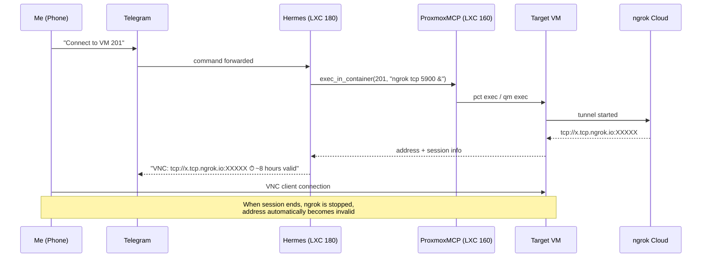

Each tunnel session is time-limited and the address changes every time — much safer than a permanently open port. Only whoever received that Telegram message knows the address, and it stops working automatically.

---

## Donor VM System

```mermaid
flowchart LR
    subgraph DONORS["Donor VMs (stopped — templates)"]
        D200["VM 200\nUbuntu + Chrome + worker\n2c/2GB/40GB"]
        D_WIN["Windows Donor\nWindows 10/11 + dev tools"]
        D_AND["VM 210\nAndroid · BlissOS 12L\n2c/4GB/32GB"]
    end

    subgraph LIVE["Clones (running)"]
        VM201["VM 201\nscraper-worker-01"]
        VMTEST["Test VM\ntemporary"]
        VMDEV["Dev VM\nproject-specific"]
    end

    D200 -->|clone_resource| VM201 & VMTEST
    D_WIN -->|clone_resource| VMDEV

    AGENT["Hermes / AI Agent"] -->|clone → start → ngrok| VM201
```

**Flow:**
1. Telegram / Kiro: *"Need a new scraper worker"*
2. `clone_resource(200, 202)` → `manage_power(202, "start")`
3. VM ready, ngrok tunnel opens, VNC address arrives on Telegram
4. When done: `remove_resource(202)` — no trace left

---

## Telegram Notifications

The last step of most N8N workflows is a Telegram message through Hermes:

| Scenario | Trigger |
|----------|---------|
| Morning infra report | Daily cron → `infra_status` → Hermes |
| Service down | HTTP probe failed → Hermes |
| Monitoring bot result | Page change detected → Hermes |
| Operation complete | Clone / backup / deploy → Hermes |
| Third-party app update | N8N cron → `exec_in_container` → package check → Hermes |
| External API trigger | RSS feed / webhook / ping failed → Hermes |

### Third-Party Application Update Tracking

I have applications installed manually inside LXCs — Gitea, AdGuard, N8N, custom tools. When a new version is released, no notification arrives anywhere. To solve this, a single Telegram message to Hermes is enough:

> *"Check Gitea and AdGuard for updates, notify me if there are any, and set up a daily cron at 08:00"*

Hermes translates this into the following steps:

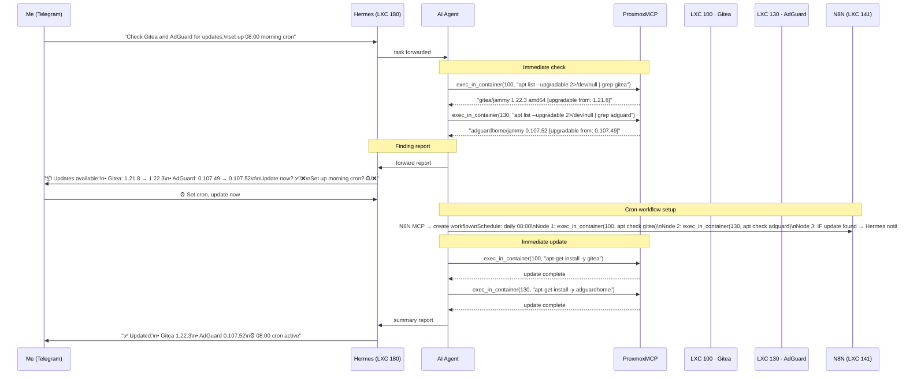

From that morning on, the workflow runs every day at 08:00. If nothing needs updating, it stays silent. When an update is released, it lands on Telegram — then I decide whether to apply it.

**This pattern extends to any service:** Docker image updates (`docker pull` + new digest check), Python package updates (`pip list --outdated`), npm/node packages, custom binaries via GitHub Releases API — all using the same `exec_in_container` + N8N + Hermes chain.

---

## LXC 141: Docker Host

```
LXC 141 — docker-host-default (192.168.1.141)
4 cores / 4 GB RAM / 20 GB ZFS
unprivileged + nesting=1 + keyctl=1 + fuse=1
│
├── n8n             (n8nio/n8n:latest)       :5678   Workflow automation engine
├── mem0-server     (mem0-mem0)               :8888   Semantic vector memory API
├── mem0-postgres   (pgvector/pgvector:pg17)          PostgreSQL 17 + pgvector
├── 9router         (9router-custom)                   AI gateway — 40+ providers
└── watchtower      (containrrr/watchtower)            Automatic Docker image updates
```

The `nesting=1 + fuse=1 + keyctl=1` combination is required for Docker-in-LXC to work reliably on Proxmox.

**Watchtower** is worth highlighting — it periodically checks Docker images and automatically updates containers when a new version is released. Update tracking is largely self-managing for Docker-based services. APT-installed services (Gitea, AdGuard) still require the `exec_in_container` + N8N cron approach.

---

## Monitoring Bot Flow

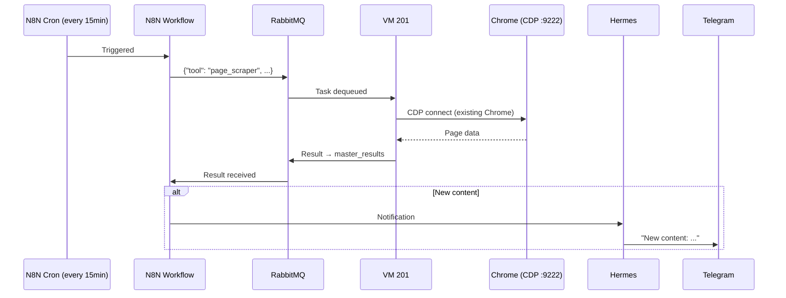

Connecting to an existing Chrome session via Chrome DevTools Protocol makes the automation indistinguishable from normal browser activity — the same approach used by Playwright and Puppeteer.

---

## Portability and Zero-PC Setup

### The Problem

Personal development environments tend to become immovable. Hardcoded paths, configurations scattered across machines, the "it only works on my machine" situation. When a PC changes or a disk fails, rebuilding takes hours or days.

I refused to accept this and designed CihadEnv with portability as a first principle from the beginning.

### CihadEnv Architecture: Brain + Body

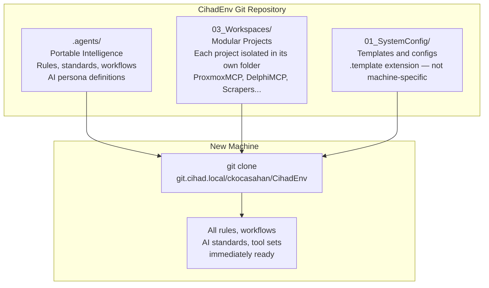

**The `.agents/` folder is portable intelligence.** It contains:
- AI behavior standards and persona definitions (Delphi profile, general profile, infra profile)
- Project management rules
- Workflow definitions (delphi-compile, delphi-write, scraper-run, infra-deploy...)
- Encoding standards
- Anti-pattern lists and best practices

Clone this folder to a new machine and Kiro, Claude, or Antigravity immediately operates with the same "CihadEnv mindset" — nothing needs to be re-explained.

### Portability Rules

**No absolute paths.** No fixed drive paths in any script, configuration, or code:

```powershell
# FORBIDDEN
$path = "D:\CihadEnv\03_Workspaces\..."

# REQUIRED
$path = Join-Path $PSScriptRoot "..\03_Workspaces\..."
# or
$path = Join-Path $env:USERPROFILE "CihadEnv\..."
```

**`.template` files.** Machine-specific configurations (IDE settings, MCP connection details) are kept in the repo with a `.template` extension. On a new machine, the template is copied and machine-specific values are filled in — the repo stays clean.

**Git `autocrlf` active.** Since this is a Windows-focused setup, CRLF compatibility is maintained at the Git level.

### Moving Without Memory Loss

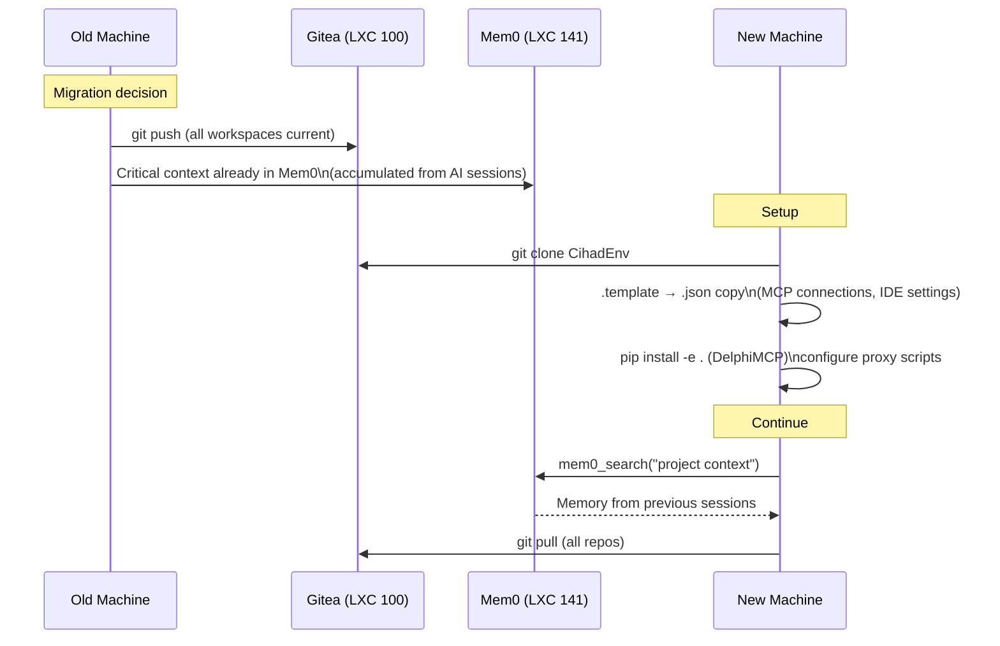

The Proxmox server stays completely separate — services keep running there. Only the Windows workstation changes. Clone the repo from Gitea, configure the templates, and **you're back to where you left off**.

Further: Mem0 stores cross-session memory. The AI agent retrieves what it learned in previous conversations from this vector database. Even if the PC changes, "we made this decision in that project" knowledge isn't lost.

---

## Centralized Secret Management

### The Problem

Keeping credentials for different services in different places leads to chaos: Docker `env` files, `.env` files scattered inside LXCs, Windows-side proxy scripts, Proxmox API tokens — each in a different location, each in a different format.

### Solution: Single Source, Layered Access

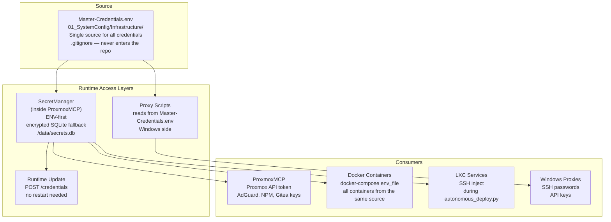

**`Master-Credentials.env`** is the single source of truth. Simple format:

```
PVE_HOST=192.168.1.123
PVE_USER=root@pam
PVE_PASS=...
ADGUARD_URL=http://192.168.1.28:3000
ADGUARD_PASS=...
GITEA_TOKEN=...
N8N_API_KEY=...
MEM0_API_KEY=...
```

This file is in `.gitignore` — it never enters the repo. On a new machine, `Master-Credentials.env.template` is copied and values are filled in.

**SecretManager** reads this file at application startup. If an ENV variable exists it uses that, otherwise it uses the encrypted SQLite value. Runtime update without restart:

```bash
curl -X POST http://192.168.1.60:8000/credentials \
  -d '{"key": "PVE_PASS", "value": "new_password"}'
```

### Consumption at Different Layers

| Layer | How it reads | Where it's used |
|-------|-------------|-----------------|
| ProxmoxMCP | `SecretManager` → ENV/SQLite | Proxmox API, AdGuard, NPM, Gitea |
| Docker containers | `docker-compose env_file` | Each container takes what it needs |
| LXC services | `autonomous_deploy.py` SSH inject | Written to container during deploy |
| Windows proxies | Direct file read | SSH passwords, API keys |
| DelphiMCP | Same pattern | Build tools, repo access |

In a team or production context, this layer is straightforwardly replaceable with HashiCorp Vault, Infisical, or any open-source vault solution — only the read source of `SecretManager` changes, application code stays the same.

---

## Data Security and Backups

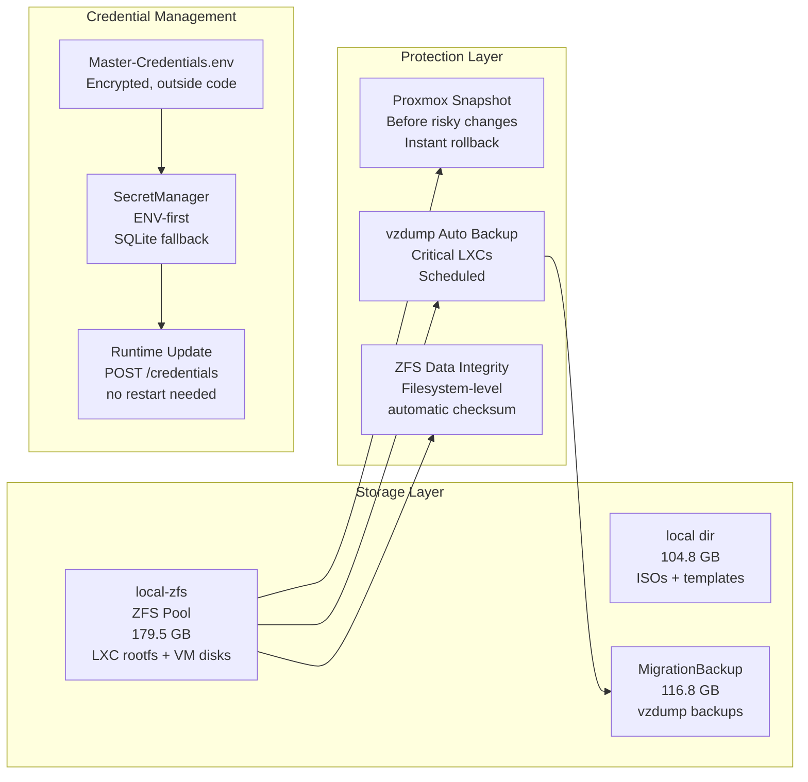

**ZFS:** All LXC and VM disks on ZFS pool. Filesystem-level checksum — silent data corruption (bit rot) is detected and repaired by ZFS automatically.

**vzdump backups:** Scheduled automated backups of critical LXCs written to `MigrationBackup`. Any LXC can be restored to a previous state as long as the backup exists.

**Snapshot:** Instant snapshot before any risky change (major update, config change). Something goes wrong — single-click rollback.

**Credential architecture:** No credentials in application code. `SecretManager` loads from `Master-Credentials.env` at startup (ENV-first), with an encrypted SQLite fallback. Runtime update without restart:

```bash
curl -X POST http://192.168.1.60:8000/credentials \
  -H "Content-Type: application/json" \
  -d '{"key": "PVE_PASS", "value": "new_password"}'
```

For teams, this layer is straightforwardly replaceable with any open-source vault solution (HashiCorp Vault, Infisical, etc.) — the application layer doesn't change, only the read source of `SecretManager`.

---

## Windows → Proxmox: stdio Proxy Bridge

AI clients on Windows speak MCP over stdio. Proxmox services expose MCP over SSE/HTTP. Four Python proxies bridge the gap:

```
Windows
├── stdio_proxy.py      ──HTTP/SSE──► ProxmoxMCP :8000/sse
│     Manages MCP handshake on behalf of the remote server.
│     server/discover → -32601 (capability cache, SSE bridge)
│
├── hermes_mcp_proxy.py ──SSH──► Proxmox host ──pct exec 180──► hermes mcp serve
│
├── n8n_mcp_proxy.py    ──SSH──► LXC 180 ──► N8N MCP server
│
└── mem0_mcp_proxy.py   ──HTTP──► Mem0 API :8888
```

Protocol detail in `stdio_proxy.py`: when an MCP client sends `server/discover` (a newer spec addition the remote SSE server doesn't implement), the proxy replies with `-32601 Method not found` — the client falls back to standard `initialize` without any timeout. This edge case isn't covered in any official documentation; it was diagnosed from raw JSON-RPC traffic analysis.

---

## Docker and LXC Tools: Direct Access from Proxmox to Container Interiors

ProxmoxMCP reaches not just LXC-level operations but also Docker containers inside LXCs — directly through MCP tools. No need to SSH into an LXC or open a separate Docker management panel.

### Docker Tool Catalog

| Tool | Function |
|------|----------|
| `docker_ps(vmid)` | List all containers in an LXC (name, image, status, ports) |
| `docker_images(vmid)` | List available Docker images |
| `docker_start/stop/restart(vmid, container)` | Container lifecycle |
| `docker_remove(vmid, container)` | Remove a container |
| `docker_logs(vmid, container, tail)` | Container log output |
| `docker_inspect(vmid, container)` | Env, mount, network details |
| `docker_stats(vmid)` | Live CPU/RAM usage for all containers |
| `docker_exec(vmid, container, command)` | Run a command inside a container |
| `docker_pull(vmid, image)` | Pull an image |
| `docker_compose_up(vmid, compose_dir)` | Run `docker compose up -d` |
| `docker_compose_down(vmid, compose_dir)` | Run `docker compose down` |
| `docker_compose_logs(vmid, compose_dir)` | Compose project logs |
| `write_file_to_lxc(vmid, remote_path, content_b64)` | Write any content to an LXC filesystem (base64 encoded) |
| `deploy_to_lxc(vmid, local_path, remote_path)` | Copy a file from Proxmox host to an LXC |
| `mcp_deploy_file(local_path, remote_path)` | Deploy to the ProxmoxMCP LXC + restart container |

### Access Layers: From LXC Down to Docker

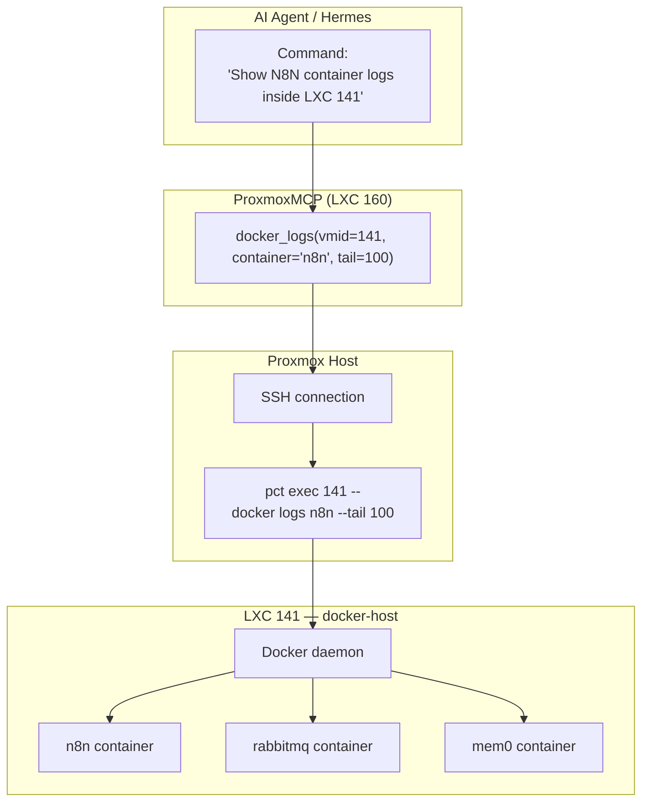

This chain works the same for every Docker command: AI agent calls the MCP tool → ProxmoxMCP connects via SSH to the Proxmox host → runs the command inside the LXC via `pct exec` → result comes back. No intermediate panel.

### File Transfer and Deploy

`write_file_to_lxc` writes any base64-encoded content directly to an LXC filesystem. `mcp_deploy_file` is specific to updating ProxmoxMCP itself: write a new tool file and restart the container in a single call.

Example — adding a new tool to ProxmoxMCP:

```
1. AI agent produces the new tool.py
2. write_file_to_lxc(160, "/tmp/new_tool.py", content_b64) — upload to Proxmox host
3. mcp_deploy_file("/tmp/new_tool.py", "/opt/proxmox-mcp/tools/new_tool.py", restart=True)
4. ProxmoxMCP container restarts, new tool is available
```

---

## MCP Layers and Integration

Multiple MCP servers run alongside each other in this infrastructure, each complementing the others. Each one emerged to solve a different problem; together they form a single control plane.

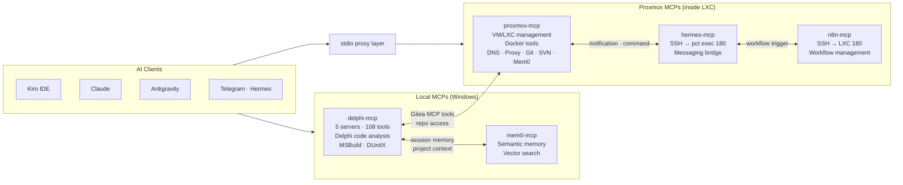

### Which MCP Engages When

**Delphi development scenario:**
1. `delphi-mcp-intel` — analyze source code, calculate blast radius
2. `delphi-mcp-action` — apply safe refactoring
3. `proxmox-mcp (gitea_tools)` — commit to Gitea
4. `hermes-mcp` → `n8n-mcp` — trigger CI/CD workflow
5. `proxmox-mcp (docker_tools)` — start test container, run build
6. `hermes-mcp` — deliver result to Telegram

**Infrastructure update scenario:**
1. `proxmox-mcp (docker_tools)` → `docker_ps(141)` — what containers are running?
2. `proxmox-mcp (exec_in_container)` — check updates with `apt list --upgradable`
3. `n8n-mcp` — create daily check workflow
4. `hermes-mcp` — update notification to Telegram

**New service deploy scenario:**
1. `proxmox-mcp (create_lxc)` — new LXC
2. `proxmox-mcp (write_file_to_lxc)` — write docker-compose.yml
3. `proxmox-mcp (docker_compose_up)` — start the service
4. `proxmox-mcp (orchestration)` → `deploy_service` — DNS + NPM proxy automated

Each MCP is a specialist in its own domain; the AI agent decides which one to call based on the task. In practice some of these integrations are still evolving — but the architecture is designed around this vision and the tools support this flow.

**LXC 100 — 192.168.1.25 — 1c/1GB/30GB**

Personal projects, works-in-progress not yet ready for GitHub, and internal tooling. Accessible at `git.cihad.local` on the local network, or through a Hermes tunnel from outside.

The strong point is AI agent integration. From my phone via Hermes, I can instruct an agent to open a branch, make commits, or trigger a webhook on a repo — then verify the result in a cloned test VM. No need to be at a desk.

MCP tools: `gitea_create_repo`, `gitea_list_repos`, `gitea_create_branch`, `gitea_list_branches`, `gitea_create_issue`, `gitea_add_webhook`.

---

## Full System Diagram

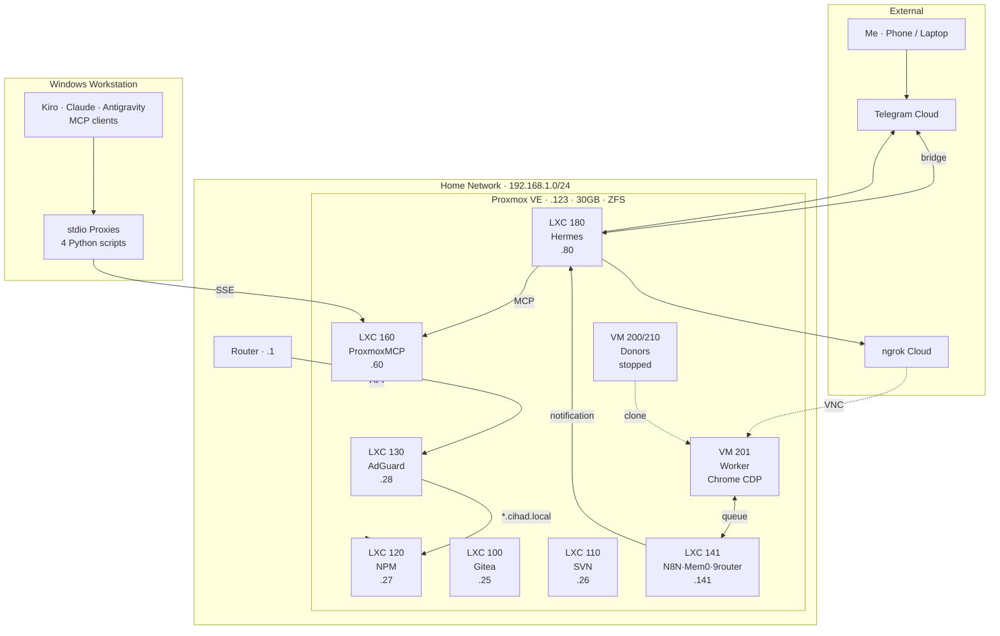

---

## DelphiMCP: A Custom Solution for AI Editor Blind Spots

### Why It Was Built

AI code editors (Kiro, Claude, Cursor, etc.) hit serious blind spots with Delphi. `.pas` and `.dfm` files get treated as plain text; the component model, `uses` dependency chains, interface/implementation sync requirements, and the mandatory UTF-8 BOM + CRLF encoding are all invisible. The result: the editor writes code, but the changes silently introduce build errors, corrupt Turkish characters, or create DFM/PAS desynchronization.

DelphiMCP is a purpose-built MCP server for this exact problem — 5 specialized servers, 108 tools, a parsing engine that treats Delphi source as structured data instead of raw text.

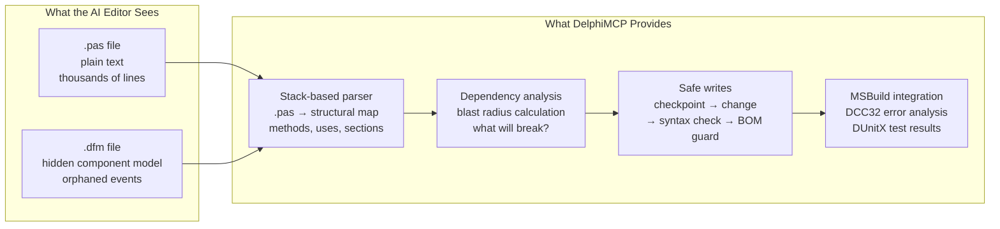

### Architecture: 5 Servers, 108 Tools

```
delphi-mcp-master    Orchestration — pipeline, hook, rule, persona, checkpoint
delphi-mcp-intel     Analysis/read — pas_*, dfm_*, proj_*, search_*
delphi-mcp-action    Refactoring/write — refactor_*, scaffold_*
delphi-mcp-quality   Quality/QA — quality_*, encoding, BOM, syntax
delphi-mcp-ops       OPS — telemetry, session, profile, runbook
```

Every tool operates as `(JSON input) → operation → (JSON output)` — no session state. Every call is archived as `logs/mcp_outputs/<tool>_<trace_id>.json`.

### Core Features and Why They Matter

**Automatic encoding protection**
Every `.pas` and `.dfm` in Delphi must be saved as UTF-8 BOM + CRLF — at least for projects with Turkish characters, this is the solution I settled on. Delphi historically worked with Windows-1254 (ANSI Turkish); modern IDEs support UTF-8 but files saved without BOM can have Turkish characters silently corrupted. I encoded this requirement as a rule and added automatic checks to all tools — there may be better or different approaches, but I stopped living with this problem. Every write tool checks BOM automatically after the operation; if missing, `_bom_warning` is added and `quality_fix_encodings` is suggested.

> For the broader background on this issue, see the [Delphi Encoding History](#delphi-encoding-history-a-two-year-problem) section.

**Stack-based parser — no pure regex**
Using pure regex to parse Delphi source is prohibited (Golden Rule #5). The custom parser handles nested `begin..end` blocks, `uses` chains, and conditional define blocks correctly.

**Blast radius analysis — measure impact first**
Before any change, `proj_find_dependents` calculates how many units will be affected. Breaking points are known before any rename, parameter addition, or method body change.

**Safe apply pipeline**
`refactor_safe_apply_orchestrator` in a single call:
1. Dependency analysis (blast radius)
2. Checkpoint (rollback point)
3. Apply changes
4. Syntax check
5. BOM + encoding validation
6. Pre-commit guard

**Windows Registry IDE discovery**
MSBuild path and Delphi IDE installation are auto-detected from the Windows Registry — no hardcoded paths, works with any Delphi version.

**Hook and rule engine**
Per-project `.delphi_mcp/hooks.json` and `rules.json`:

```json
{
  "hooks": {
    "post_rename":  ["quality_check_syntax", "build_run_tests"],
    "post_bugfix":  ["build_run_tests", "workflow_pre_commit_guard"],
    "on_failure":   ["checkpoint_list"]
  },
  "rules": [
    {"id": "utf8-enforce", "tool": "quality_fix_encodings", "trigger": "post_commit", "severity": "error"},
    {"id": "no-sql-concat","tool": "quality_fix_sql_concat", "trigger": "post_operation", "severity": "warn"}
  ]
}
```

### Selected Tools

| Layer | Tool | What it does |
|-------|------|-------------|
| L2 Read | `pas_analyze_unit_full` | Full unit report: members, uses, sections |
| L2 Read | `dfm_read_events` | DFM event→method mappings (static + runtime) |
| L2 Read | `dfm_read_all_sql` | All embedded SQL queries in a form |
| L3 Impact | `proj_find_usages` | All usages of a symbol across the project |
| L3 Impact | `proj_extract_call_graph` | Call flow from a method entry point |
| L3 Impact | `dfm_sync_pas_declarations` | All DFM components declared in PAS? |
| L4 Write | `refactor_rename_symbol` | Safe project-wide rename (.pas + .dfm) |
| L4 Write | `refactor_add_parameter` | Add parameter + update all call sites |
| L4 Write | `quality_fix_empty_except` | Replace silent except blocks with logging template |
| L4 Write | `quality_fix_encodings` | Bulk UTF-8 BOM + CRLF enforcement |
| L5 Orch. | `build_run_msbuild` | Compile with MSBuild, JSON error/warning analysis |
| L5 Orch. | `workflow_pre_commit_guard` | Quality gate before commit |
| L5 Orch. | `checkpoint_create/restore` | Snapshot before changes, single-command rollback |
| L5 Orch. | `report_code_health` | Project health score (0-100) + grade (A-D) |

### This Pattern Works for Any Stack

DelphiMCP was written to solve Delphi-specific problems — but the architecture is universal:

- **Language-specific parser** → structural analysis for any language
- **Encoding guard** → enforcement of any character set requirement
- **Blast radius analysis** → any dependency graph
- **Safe apply orchestrator** → any "analyze → checkpoint → apply → verify" loop

The same MCP pattern applies to Python, TypeScript/JavaScript, or any other stack. Delphi was the first real use case for this infrastructure.

---

## Telegram-Approved Code Change Scenario

Making code changes and testing them without being at a desk:

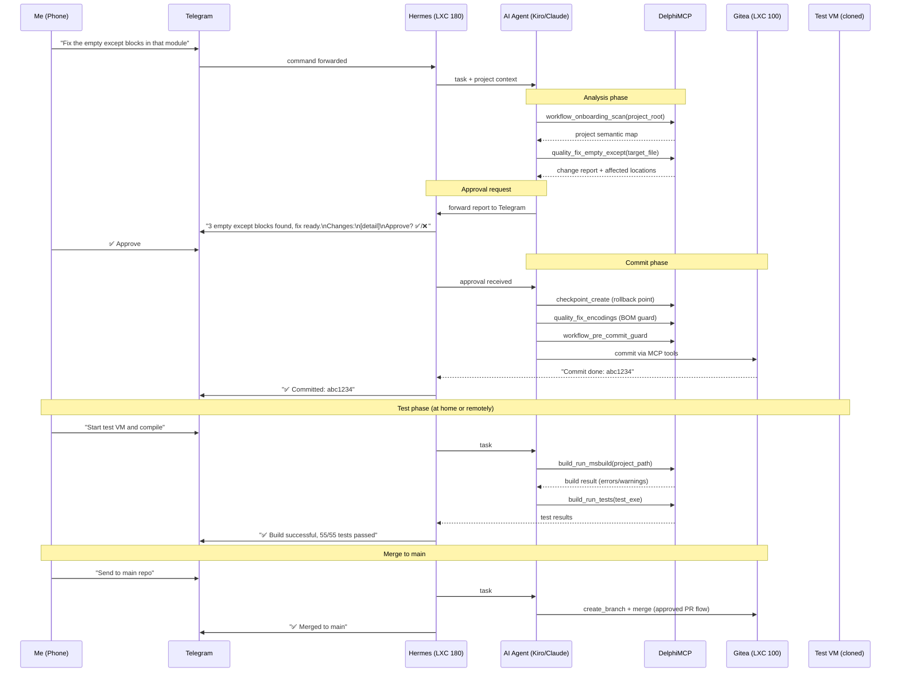

**The real value of this scenario:**

A problem occurs to me while leaving the house. I pull out my phone, send the task to the AI agent via Telegram. The agent analyzes — which files will be affected, what will change — and sends me a summary report. I approve, the agent commits. When I get home, the only thing left is to run the build and tests in the test environment. The heavy lifting was already done.

The approval mechanism is the critical part: the agent doesn't commit without first presenting "here's what I'm going to change" and asking. Nothing changes blindly without being seen and understood first.

---

## What This Architecture Can Serve

| Area | What this infrastructure provides |
|------|-----------------------------------|
| Dev infrastructure | Self-hosted Git + scheduled staging, isolated test VM in minutes |
| Automation & monitoring | N8N + RabbitMQ + Hermes — production-grade async workflows |
| AI-native management | MCP-driven LXC provisioning, DNS, proxy, health checks — no human intervention |
| Remote access | Donor clone + ngrok VNC — ephemeral isolated desktop, deleted when done |
| Network security | AdGuard + NPM — LAN-wide content filtering, SSL termination |
| Data security | ZFS integrity + vzdump backup + snapshot + vault-ready credential management |

---

---

## Delphi Encoding History: A Two-Year Problem

This didn't end with a single tool. Over more than two years, across different Delphi versions, different machines, and different editors, I kept hitting the same problem — each time going a bit deeper and building a more robust solution.

### The Root of the Problem

The Turkish character issue in Delphi is actually several layers stacking on top of each other:

```
File encoding on disk
      ↓
How the Delphi IDE reads the file
      ↓
How the compiler (DCC32) interprets string literals
      ↓
What appears on screen or in the database at runtime
```

Each layer can behave independently. A file can be saved with UTF-8 BOM but Delphi 2010 might read it as ANSI. Or it looks correct in the IDE but corrupts after compilation.

### Problem Types Encountered

**ANSI → UTF-8 migration chaos**
Old Delphi 2010 projects were written with Windows-1254 (ANSI Turkish). When migrating to modern Delphi (`D11`, `D12`), files get converted to UTF-8 — but if BOM isn't added or the conversion isn't done correctly, corruptions like `ş` → `Å` or `ğ` → `ı` appear. Manually checking each file took hours.

**AI editor interventions**
AI code editors don't pay attention to encoding when writing files. When Kiro or Claude writes to a `.pas` file, whether it preserves the BOM is unpredictable — sometimes it does, sometimes it writes without UTF-8 BOM, sometimes it converts line endings to LF. After every intervention, Turkish characters had to be manually tested.

**Source control transfers**
When files come through Git, SVN, or another tool, encoding metadata may not be preserved. Especially in Windows–Linux cross-operations, CRLF→LF conversion causes `.pas` files to open slowly in the Delphi IDE or introduces character corruptions.

**Char escaping workaround**
In some critical places where encoding couldn't be trusted, writing Turkish characters directly as character codes (`#351` = ş, `#305` = ı) was necessary. Not a permanent solution, but it was the only reliable approach at the time.

### The Approach I Found

To stop the problem from repeating every time, I embedded the "encoding verification" step into the development flow:

1. **Project-wide BOM check** — `quality_check_bom` scans all `.pas/.dfm/.dpr/.inc` files, lists those missing BOM
2. **Bulk fix** — `quality_fix_encodings` converts all of them to UTF-8 BOM + CRLF
3. **Automatic post-write check** — after every `refactor_*` or `quality_fix_*` call, the BOM guard runs automatically; if missing, `_bom_warning` is returned
4. **Pre-commit gate** — `workflow_pre_commit_guard` makes encoding verification mandatory before commits
5. **Rule engine** — the `utf8-enforce` rule in `.delphi_mcp/rules.json` runs as a post-commit hook

This approach worked for me and made the problem manageable. But Delphi's encoding issue runs deep, behavior varies by version, and this is the best approach I know — not necessarily the only or most correct one.

> **Note:** These notes reflect experiences from 2024–2026. Delphi and AI tooling continue to evolve — some of these issues may be automatically resolved in more recent versions.

---

*Cihad Kocaşahan — [github.com/cihadkocasahan](https://github.com/cihadkocasahan) — [linkedin.com/in/cihadkocasahan](https://linkedin.com/in/cihadkocasahan)*
