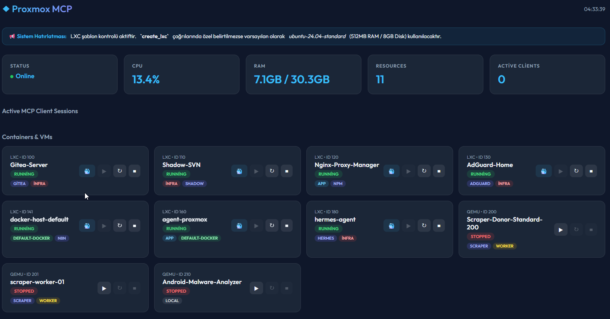
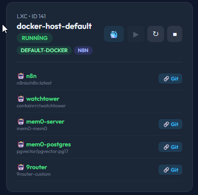
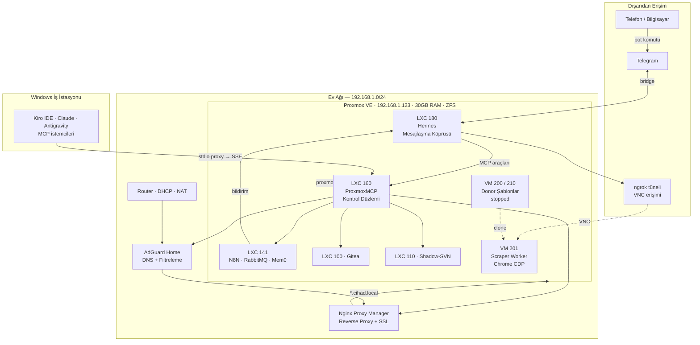

# Ev Laboratuvarı & AI Kontrol Düzlemi

> Kişisel Proxmox VE altyapısı — her operasyon bir MCP aracı, her yönetim bir konuşma.

**→ [English version](README_EN.md)** | **→ [Teknik Detaylar](DETAILS.md)**

---

*Özel ProxmoxMCP Web Kontrol Paneli (`:8000/dashboard`) — İhtiyaçtan geliştirdiğim, tüm LXC, VM ve konteyner kaynaklarını tek bakışta izleyip yönetebildiğim canlı arayüz.*

 

  
   
  <em>LXC 141 (docker-host) Konteyner Detayı — N8N, Watchtower, Mem0 (pgvector) ve 9router servisleri.</em>

---

## Nasıl Başladı

Aslında ilk motivasyon basitti: çocuklar için içerik filtreleme ve evdeki tüm cihazlarda reklam engelleme istiyordum — hem de her cihaza tek tek uğraşmadan. O sırada köşede toz toplamaya aday eski bir PC vardı; çöpe atmak yerine bir işe yarasın diye kullanmaya karar verdim.

AdGuard Home'u doğrudan o makineye kurdum, Proxmox falan yoktu henüz. Modem tarafında DHCP üzerinden dağıtılan DNS adresini AdGuard'ın IP'siyle değiştirdim. Böylece telefon, TV, bilgisayar, misafirin telefonu — hiçbir cihazda ayar yapmadan hepsi otomatik olarak reklamdan ve istenmeyen içerikten arındı. Birkaç yüz MB RAM'le çalışan bu kurulum makinenin kapasitesinin neredeyse hiçbirini kullanmıyordu. Ama makinenin geri kalan gücü boşta duruyordu ve bu beni rahatsız etmeye başladı. *"Madem bu kadar kaynak var, neden sadece DNS?"* sorusu her şeyin başlangıcı oldu.

Makineye Proxmox kurdum. İki SSD'yi ZFS mirror olarak yapılandırdım — biri bozulsa bile sistem çalışmaya devam edecek, veri kaybı yaşanmayacaktı. Üzerine AdGuard'ı bir LXC konteynerine taşıdım; artık aynı makinede birden fazla izole servis çalıştırabilecektim.

Servisler çoğaldıkça IP ve port ezberlemek can sıkıcı hâle geldi. Nginx Proxy Manager'ı kurdum, AdGuard'a DNS rewrite kuralları ekledim. Artık `adguard.cihad.local` ya da `proxmox.cihad.local` yazmak yetiyordu; DNS ismi çözüyor, NPM doğru servise yönlendiriyordu. Basit bir ayar, ama altyapıya ilk kez *"düzenli bir ev"* hissi verdi.

Bir süre sonra bir web sitesini düzenli takip etmem gerekti. Elle kontrol etmek yerine N8N kurdum ve workflow yazdım. Çok geçmeden duvara çarptım: site bot koruması uyguluyordu. Çözüm, gerçek bir tarayıcı gibi davranmaktı. Mevcut Chrome'a DevTools Protocol üzerinden bağlanmayı denedim ve çalıştı. Yük arttıkça işleri sıraya almak gerekti; araya RabbitMQ koydum, ayrı bir VM'i de worker yaptım. Eski PC için bu ilk *"gerçek iş yükü"* sınavıydı ve hiç şikayet etmeden geçti.

Sonucu Telegram'a bildirim olarak göndermek istedim. Telegram aslında yeni değildi — daha önceki bir projede basit bildirimler için kullanmıştım. Ama işler geliştikçe aklıma takıldı: sadece bildirim değil, doğrudan komut gönderip altyapıyı da yönetebilir miyim? Uzaktan kontrol amaçlı Telegram bot çözümlerini araştırırken Hermes'i keşfettim. Sadece Telegram değil, Discord, Signal, Slack — hepsini tek bir bridge'e bağlayan, üzerine özel komutlar tanımlanabilen bir araç. Kurdum, test ettim; işe yaradı. Mesajlaşma uygulaması zaten cebimdeydi; neden ayrı bir panel açayım ki?

Bir gün ofiste bir VM'e erişmem gerektiğinde bu köprünün faydasını bizzat gördüm. Klasik yol kalıcı bir VPN kurmak ya da dışarıya port açıp orada bırakmaktı; ikisi de bana gereksiz bir güvenlik riski gibi geldi. Bunun yerine ngrok + VNC entegrasyonu yaptım: Telegram'dan tek bir mesaj, birkaç saniye sonra süre sınırlı geçici bir bağlantı adresi cebimde. İş bitince tünel kapanıyor ve arkasında hiçbir açık kapı bırakmıyordu.

Bu dönemde AI modellerini altyapıya dahil ederken başka bir sorun dikkatimi çekti: birden fazla AI sağlayıcısı kullanıyordum — Claude, Gemini, Groq ve bazı ücretsiz endpoint'ler. Her birinin farklı rate limiti, farklı ücretsiz kotası ve farklı güçlü yönleri vardı. Birinin limiti dolunca diğerine geçmek, maliyeti dengelemek giderek karmaşıklaşıyordu. Başta kendi proxy çözümümü yazdım. Bir süre işe yaradı ama sağlayıcılar endpoint ve auth yapılarını sık sık değiştirince takip etmek zorlaştı. O noktada açık kaynak ve aktif güncellenen 9router'ı buldum. MIT lisanslı, OpenAI uyumlu yerel bir gateway — 40'tan fazla sağlayıcıyı destekliyor, otomatik fallback yapıyor ve token optimizasyonu sağlıyor. Bunu da Proxmox'a bir LXC içine kurdum. Artık hem yerel araçlar hem de Hermes tek bir adrese bakıyor; hangi modelin devreye gireceğini 9router hallediyordu.

Bir sorun daha vardı: her AI oturumu sıfırdan başlıyordu. Dün konuştuğumuz şey, geçen hafta verdiğimiz mimari karar — bir sonraki oturumda kayboluyordu. Aynı bağlamı her seferinde baştan anlatmak hem zaman kaybı hem token israfıydı. Mem0'ı keşfedince bu sorun çözüldü. PostgreSQL 17 + pgvector üzerine kurulu, Gemini embedding ile semantik arama yapan yerel bir vektör bellek motoru. Kararları kaydediyor, bir sonraki oturumda geri çağırıyor. Onu da Proxmox'taki docker-host LXC içine kurdum.

Artık elimde onlarca servis, konteyner ve güçlü bir AI omurgası vardı. Fakat bu sefer başka bir sürtünme noktası doğdu: Proxmox'u, Docker konteynerlerini, DNS kayıtlarını ve reverse proxy ayarlarını yönetmek için sürekli farklı web arayüzlerine girip çıkmak, SSH terminalleri açmak gerekiyordu. *"Tüm bu altyapıyı yapay zeka ajanlarının doğrudan konuşup yönetebileceği tek bir arayüzde birleştiremez miyim?"* sorusu **ProxmoxMCP**'yi doğurdu. FastMCP ve FastAPI üzerine kurduğum bu kontrol düzlemi sayesinde artık 60'tan fazla altyapı operasyonu (LXC/VM yaşam döngüsü, Docker işlemleri, AdGuard DNS kayıtları, NPM yönlendirmeleri, tek adımda atomik servis kurulumu) birer standart AI aracına dönüştü. İster masamdaki IDE ajanına (Antigravity, Kiro, Claude) ister cebimdeki Telegram'a söylemek yetiyor.

Her çözüm bir sonraki ihtiyacı doğurdu. Şu an elimde, tek bir Telegram mesajıyla ya da AI ajanıyla konuşarak yönetilen, sıfırdan tasarlanmış bir altyapı var. Hiçbir parça *"yapayım da dursun"* diye kurulmadı. Ve o eski PC artık sadece reklam engellemiyor — evin beyni olarak çalışıyor.

İş sadece sunucu yönetmekle de sınırlı kalmıyor; bu merkezi akıl sayesinde evdeki tüm dinamikler birbiriyle konuşur hale geldi. Dışarıdan bakıldığında sıradan görünen bu bare-metal Proxmox yapısı; herhangi bir harici buluta, ücretli host'a veya açık portlara muhtaç olmadan inanılmaz senaryoları mümkün kılıyor — bunlar bile yapılabiliyor:
- 🛡️ **Akıllı Ebeveyn Koruması:** Çocukların tabletlerinin AdGuard DNS sorguları arka planda AI tarafından periyodik taranıyor; reklam engelleyicilerin kaçırdığı yaşa uygunsuz siteler anında otonom engellenip Telegram'a bildiriliyor.
- 🏢 **Kurumsal BT & Ticari Sistemler:** Şirketlerin ERP, MES, CRM ve veritabanı iş yüklerini izole konteynerlerde barındırma, şube VPN'leri ve yapay zeka ile otomatik BT operasyon yönetimi.
- 🔥 **Kombi & Termostat Yönetimi (Doğalgaz Tasarrufu):** Evden çıkınca kombi otomatik ekonomi moduna geçiyor; Telegram'dan *"1 saate evdeyim"* dendiğinde konfor sıcaklığına getiriliyor, pencere açıldığında ısıtma durduruluyor.
- 🚗 **Görüntü İşleme & Plaka Tanıma:** Kameralar aile aracının plakasını gördüğünde bahçe kapısını açıp karşılama ışıklarını yakıyor; yabancı bir araçta ise Telegram'a anlık kare gönderip onay istiyor.
- ❄️ **Marka Bağımsız İklimlendirme:** Salondaki sıcaklık sensörü hareket algılayıp evde olunduğunu teyit ettiğinde, üretici uygulamasına ihtiyaç duymadan klima ESP32 köprüsüyle eko modda çalıştırılıyor.
- 📡 **Otonom Ağ ve Cihaz Güvenliği:** Router'da ping veya gecikme yükseldiğinde kanal optimizasyonu tek tıkla yapılıyor; buzdolabı kapağı açık unutulduğunda tüm aileye Telegram'dan acil sesli uyarı düşüyor.

Tüm bu sistem; ek bir donanım gerekmiyorsa sadece Telegram'dan bir cümleyle, donanım gerekiyorsa cihazların yerel Wi-Fi/LAN ağına bağlı olmasıyla, zamandan ve mekandan tamamen bağımsız olarak yönetilebiliyor. *(Bu senaryoların tüm mimari açılımları ve derinlemesine teknik detayları sayfanın devamında yer almaktadır.)*

---

## Altyapıya Genel Bakış

---

## Ne Yapabiliyorum

### Herhangi Bir Yerden Tam Kontrol

Telegram veya tarayıcı (`hermes.cihad.local`) üzerinden, evde olup olmadığımdan bağımsız olarak:

- İstediğim VM veya LXC'yi başlatıp durdurmak
- Yeni servis deploy etmek (LXC oluşturma + DNS + proxy tek adımda)
- Altyapı sağlık kontrolü çalıştırmak
- N8N workflow tetiklemek
- **Herhangi bir VM'e ngrok üzerinden geçici VNC bağlantısı açmak**

Kiro IDE, Claude Desktop veya Antigravity gibi MCP destekli herhangi bir AI istemcisi de aynı araçlara bağlanabiliyor. Altyapıyı konuşarak yönetmek benim için sıradan bir iş akışı.

### Anında İzole Ortam

Farklı işletim sistemlerinden (Ubuntu, Windows, Android/BlissOS) önceden yapılandırılmış donor VM'lerim var. Hermes üzerinden Telegram'dan bir komutla:

1. Donor VM klonlanır
2. Başlatılır
3. ngrok tüneli açılır, VNC adresi Telegram'a düşer
4. İş bitince silinir — iz kalmaz

Web sitesi testi, uygulama denemeleri, Docker stack denemeleri — her şey izole, geçici, temiz.

### Akıllı Bildirimler

Elle kontrol etmek yerine sistemin beni uyarmasını tercih ederim. Aktif kullandığım senaryolar:

- **Sabah altyapı sağlık raporu** — her sabah otomatik, bir servis ölüyse kahvemle birlikte haber gelir
- **İzleme botu sonuçları** — periyodik takip edilen sayfada değişiklik olunca anlık bildirim
- **İşlem tamamlanma bildirimleri** — clone, backup, deploy — başlatıp bırakıyorum, bitince mesaj geliyor
- **3. parti uygulama güncelleme takibi** — Proxmox içindeki LXC ve Docker container'lara elle kurduğum uygulamaların yeni sürümü çıktığında haberim olmuyor. Hermes'e "şu servisleri kontrol et, güncelleme varsa bildir ve sabah cron'u kur" diyorum — ajan `exec_in_container` ile paket durumunu kontrol ediyor, N8N'de zamanlanmış workflow oluşturuyor, güncelleme gelince Telegram'a düşüyor
- **İstediğim her dış API** — herhangi bir servis entegrasyonu N8N + Hermes ile birkaç dakika

### Kişisel Git Sunucusu

Gitea'da yerel projelerimi tutuyorum. Yerel ağdan `git.cihad.local` ile, dışarıdan Hermes tüneli üzerinden erişiyorum. Telefon başındayken Hermes aracılığıyla AI ajana talimat verip repo üzerinde değişiklik yaptırabiliyorum, klonlanan test VM'inde sonucu görebiliyorum — PC başında olmak zorunlu değil.

### DelphiMCP: Delphi Geliştirme için AI Köprüsü

AI kod editörleri Delphi ile çalışırken ciddi kör noktalar yaşıyor — `.dfm` component modeli, `uses` zinciri, UTF-8 BOM zorunluluğu, interface/implementation senkronizasyonu. Bu sorunlar için sıfırdan bir MCP sunucu yazdım: 5 özelleşmiş sunucu, 108 araç, Delphi kaynak kodunu yapılandırılmış veri olarak işleyen özel bir parser motoru.

Sonuç: AI ajan artık Delphi projesini gerçekten "anlıyor" — proje geneli güvenli rename, blast radius analizi, MSBuild entegrasyonu, otomatik encoding koruması. Telefonda Telegram'dan görevi tarif ediyorum, ajan analiz yapıp değişiklik özetini gönderiyor, onay veriyorum, commit atılıyor.

→ Detaylar: **[DETAILS.md — DelphiMCP bölümü](DETAILS.md#delphimcp-ai-editör-çıkmazlarına-delphi-özgün-çözüm)**

### Veri Güvenliği ve Yedekleme

Veriler ZFS pool üzerinde duruyor — veri bütünlüğü dosya sistemi seviyesinde korunuyor. Proxmox'un yerleşik backup mekanizması (`vzdump`) ile kritik LXC'lerin otomatik anlık yedekleri alınıyor; yedekler ayrı bir depolama alanında (`MigrationBackup`) tutuluyor. Snapshot sistemi sayesinde riskli bir değişiklikten önce anında geri dönüş noktası oluşturulabiliyor.

Credential yönetimi uygulama kodundan tamamen ayrı — merkezi bir secrets dosyası ile `SecretManager` katmanı üzerinden çözümleniyor, SQLite tabanlı şifreli fallback ile. Hassas bilgiler ne kaynak kodda ne de ortam değişkenlerinde düz metin olarak duruyor.

---

## Servis Haritası

| VMID | Servis | IP | Kaynak | Durum |
|------|--------|----|--------|-------|
| LXC 100 | Gitea | 192.168.1.25 | 1c/1GB/30GB | ✅ running |
| LXC 110 | Shadow-SVN | 192.168.1.26 | 1c/1GB/20GB | ✅ running |
| LXC 120 | Nginx Proxy Manager | 192.168.1.27 | 1c/1GB/10GB | ✅ running |
| LXC 130 | AdGuard Home | 192.168.1.28 | 1c/4GB/5GB | ✅ running |
| LXC 141 | Docker Host (N8N + RabbitMQ + Mem0) | 192.168.1.141 | 4c/4GB/20GB | ✅ running |
| LXC 1xx | 9router — AI Gateway | — | — | LXC veya Docker |
| LXC 160 | ProxmoxMCP — Kontrol Düzlemi | 192.168.1.60 | 4c/512MB/8GB | ✅ running |
| LXC 180 | Hermes — Mesajlaşma Köprüsü | 192.168.1.80 | 2c/4GB/8GB | ✅ running |
| VM 200 | Scraper-Donor (Ubuntu+Chrome) | — | 2c/2GB/40GB | ⏸ stopped |
| VM 201 | scraper-worker-01 | — | 2c/2GB/40GB | ✅ running |
| VM 210 | Android-Malware-Analyzer (BlissOS) | — | 2c/4GB/32GB | ⏸ stopped |

*Canlı Proxmox verisinden alınmıştır. Toplam RAM kullanımı: ~8.8 GB / 30.3 GB.*

---

## Teknoloji Yığını

| Kategori | Teknoloji |
|----------|-----------|
| Hypervisor | Proxmox VE, LXC (unprivileged), KVM/QEMU |
| Depolama | ZFS (local-zfs), vzdump otomatik yedek |
| Container | Docker, Docker Compose (LXC içinde nesting) |
| Reverse proxy | Nginx Proxy Manager |
| DNS & Filtreleme | AdGuard Home |
| Otomasyon | N8N |
| Mesaj kuyruğu | RabbitMQ |
| Versiyon kontrolü | Gitea (Git), Shadow-SVN |
| Vektör bellek | Mem0, PostgreSQL 17 + pgvector |
| Mesajlaşma köprüsü | Hermes (Telegram / Discord / Signal / Slack / Matrix) |
| AI gateway | 9router (40+ sağlayıcı, otomatik fallback, token optimizasyonu) |
| Oturum hafızası | Mem0, PostgreSQL 17 + pgvector, Gemini embedding |
| AI protokolü | MCP (Model Context Protocol) — SSE + stdio proxy |
| Kontrol düzlemi | FastMCP + FastAPI (Python, ~46 satır bootstrap) |
| Uzak erişim | ngrok (TCP tünel, geçici), VNC |
| AI istemcileri | Kiro IDE, Claude Desktop, Antigravity — MCP destekli her istemci |
| Credential yönetimi | SecretManager (ENV öncelikli, SQLite şifreli fallback) |

---

## Sırada Ne Var? (Gelecek Vizyonu: AI Destekli Merkezi Özelleştirme Paradigması)

Mevcut yapı, altyapıyı **"komut alan ve konuşarak yönetilen"** bir olgunluğa ulaştırdı. Buradaki nihai amaç, piyasada tekil olarak zaten yapılabilen standart akıllı ev senaryolarını tekrarlamak değildir; **merkezi, uzaktan yönetilebilir, sıfır üretici bağımlılığı (vendor lock-in) barındıran ve yapay zeka destekli yepyeni bir özelleştirme ve kontrol mimarisi vizyonu** sunmaktır.

Klasik otomasyonlarda kullanıcı onlarca kapalı mobil uygulama, karmaşık paneller veya statik kural blokları (if-this-then-that) arasında kaybolurken; bu mimaride tüm donanım ve yazılım katmanları **tek bir merkezi yapay zeka sinir sistemine** bağlanır. Sistem kullanıcının niyetini anlar, arka planda logları analiz edip kendi kendine koruma refleksleri üretir ve fiziksel/mantıksal tüm dünyayı tek bir konuşma arayüzünden sınırsızca kişiselleştirilebilir kılar.

En büyük avantajımız ise **kendi kendine yeten Proxmox bare-metal omurgamızdır**: Dışarıdan herhangi bir ücretli bulut sunucu (VPS), harici host, genel internete açık bir domain (alan adı), statik IP veya güvenlik açığı yaratacak port yönlendirmelerine (port forwarding) hiçbir şekilde ihtiyaç duymadan tüm bu sistemi %100 yerel ve egemen olarak çalıştırabiliyoruz. Daha da ötesi; burası sadece hazır paketleri tüketen bir ortam değil, tam anlamıyla **otonom bir yazılım ve üretim fabrikasıdır**: İhtiyacımız olan her aracı, API köprüsünü ve otomasyonu anında sıfırdan kodlayabilir, derleyebilir, tek bir MCP komutuyla yeni bir izole LXC veya Docker konteyneri içinde ayağa kaldırıp canlıya alabiliriz.

> **Temel Mimari Prensibi (Sıfır Ek Karmaşa, Maksimum Esneklik):**
> - **Ek Donanım Gerekmeyen Durumlar:** Mantıksal kural tanımları, AdGuard DNS log analizi, dinamik çocuk koruması/içerik filtreleme, API tetikleyicileri ve uyarı sistemleri için hiçbir fiziksel donanım gerekmez; her şey doğrudan Telegram üzerinden doğal dille veya bot komutlarıyla yönetilir.
> - **Donanım Kontrolü Gereken Durumlar:** Kontrol edilecek cihazların (kombi, klima, termostat, aydınlatma, router, IP kamera vb.) yalnızca Wi-Fi veya kablolu LAN ile ev ağına bağlı olması ve yerel komutları (REST API, MQTT, HTTP, ONVIF veya ESP32 köprüsüyle) destekler halde olması yeterlidir.
> - **Mekandan ve Zamandan Bağımsız Yapılandırma:** Tüm bu otomasyonlar; ister ev içinden ister kilometrelerce uzaktan Telegram ile; zamana bağlı periyotlarla (cron/n8n zamanlaması), sensör veya olay tetiklemeleriyle (event-driven) ya da anlık ve plansız (ad-hoc) olarak dilediğimiz an yapılandırılabilir, devreye alınabilir veya değiştirilebilir.

### 1. Altyapı & Yazılım Refleksleri
- 🛡️ **Kendi Yarasını Saran Altyapı (Self-Healing):** Bir serviste çökme veya bellek sızıntısı olduğunda; AI ajanının logları (`docker_logs`, `exec_in_container`) inceleyip kök nedeni bulması, konteyneri kurtarması ve Telegram'a teşhis/çözüm raporu iletmesi.
- 🔄 **Yerel GitOps Döngüsü (Gitea Webhook → Otomatik Dağıtım):** Gitea'ya `git push` yapıldığı anda hiçbir panele girmeden Proxmox içindeki ilgili servisin otomatik build edilip canlıya alınması.
- 🧠 **Mühendislik Hafızası & Kod Tabanı Arama (Codebase RAG):** Yıllar içinde yazılan tüm Delphi, Python ve altyapı kodlarının Mem0 + pgvector ile semantik olarak indekslenmesi; yeni bir iş yaparken geçmiş tecrübelerin anında bağlama çağrılabilmesi.
- 🔐 **Kritik İşlemler İçin İnteraktif Onay (Telegram 2FA):** Altyapıyı etkileyecek hassas veya yıkıcı işlemler (`remove_resource`, yedek silme vb.) için Telegram üzerinden tek tıkla çalışan `[Onayla / İptal]` buton mekanizması.

### 2. Ticarileşmiş Ekosistemler & Açık Protokol Entegrasyonu (No Vendor Lock-in)
Piyasadaki akıllı cihazlar genellikle kullanıcıyı kendi kapalı bulut uygulamalarına mahkûm eder (Philips Hue, Tuya/Smart Life, Xiaomi/Aqara, Sonoff, Samsung SmartThings, LG ThinQ vb.). Hedef; standartlaşmış açık protokoller (**MQTT, Zigbee2MQTT, Matter/Thread, Home Assistant**) üzerinden tüm bu bağımsız dünyaları tek bir Telegram/Hermes kontrol düzleminde birleştirmektir:
- **Aydınlatma & Enerji:** Philips Hue, Shelly ve Tuya rölelerinin marka farkı gözetmeksizin aynı mantıkla yönetilmesi.
- **İklimlendirme & Isıtma:** Daikin, Mitsubishi, Arçelik klimalar; DemirDöküm, Vaillant, Bosch, Buderus, Baymak kombiler ve Tado, Netatmo, Cosa akıllı oda termostatlarının üretici sınırlarına takılmadan orkestre edilmesi.
- **Ağ Donanımları:** Evdeki Keenetic, MikroTik, Ubiquiti UniFi veya ASUS router/AP'lerin API'leri üzerinden telemetri ve yönetim köprüsü.

### 3. ESP32 ile "Akılsız" Cihazları Özgürleştirme
Piyasadaki ticari üreticilerin izin vermediği veya fabrikasyon olarak akıllı özelliği bulunmayan cihazlar için **özel yapılandırılmış ESP32 mikrodenetleyicileri** (ESPHome / Tasmota tabanlı) devreye girer:
- Standart bir split klimaya kızılötesi (IR) alıcı/verici ekleyerek üretici bulutuna ihtiyaç duymadan yerel Wi-Fi üzerinden tam kontrol sağlama.
- Akıllı olmayan geleneksel kombilere kuru kontak röle (Dry Contact) veya OpenTherm köprüsü ekleyerek, pahalı tescilli oda termostatlarına gerek kalmadan evin her odasındaki ucuz Zigbee/BLE sensörleriyle entegre akıllı bir ısıtma sistemi inşa etme.
- Garaj kapısı motorlarına, buzdolaplarına veya beyaz eşyalara çevre sensörleri (DHT22, BME280) bağlayarak üretici yazılımlarının hayal bile edemeyeceği özel senaryolar kurgulama.

### 4. Bilgisayarlı Görü (Computer Vision) & AI Kamera Güvenliği
- **Kamera Akışları (RTSP):** Hikvision, Dahua veya Reolink güvenlik kameralarından gelen canlı akışların yerel AI modelleriyle (YOLO, Frigate NVR) işlenmesi.
- **Otomatik Plaka Tanıma (ALPR/ANPR):** Araç plakalarının gerçek zamanlı okunması; kullanıcı tanımlı beyaz liste (whitelist) ve kara liste (blacklist) kuralları ile fiziksel bariyerlerin tetiklenmesi.

### 5. AI Destekli Dinamik Ebeveyn Koruması & Akıllı DNS Filtreleme
Bu altyapının en baştaki doğuş sebebi olan AdGuard Home içerik filtrelemesi, yapay zekanın analitik gücüyle birleşerek statik kara listelerin ötesine geçer:
- **Sabit IP ve MAC Tabanlı Cihaz Tanıma:** Evdeki cihazların (çocukların tabletleri, okul bilgisayarları, akıllı TV'ler, misafir cihazları) MAC adresi ve DHCP rezervasyonu ile AdGuard'da profillenmesi.
- **Log Taraması & Semantik Risk Analizi:** Klasik blok listelerinin (blocklist) henüz yakalayamadığı yeni açılmış, şüpheli veya çocukların yaş grubuna uygun olmayan sitelerin AdGuard sorgu geçmişinden (`adguard_status`, query logs) periyodik olarak taranması.
- **Yerel LLM ile Otonom Kural Güncellemesi:** 9router üzerindeki modelin alan adını ve bağlamını değerlendirip sakıncalı bulduğu anda `adguard_add_filter` ve `adguard_set_custom_rules` araçlarıyla filtreleri otonom olarak güncellemesi ve ebeveyne anlık rapor sunması.

### 6. Evden İşletmeye: Kurumsal BT & Ticari Sistemler Omurgası (From Homelab to Enterprise IT)
Bu yapı her ne kadar bir ev laboratuvarında doğmuş olsa da; mimari olgunluğu ve izolasyon kabiliyeti sayesinde **herhangi bir KOBİ veya kurumsal işletmenin merkezine oturabilecek** tam teşekküllü bir BT operasyon merkezidir:
- **Ticari Sistemler & Veritabanı Barındırma:** Şirketin ERP, MES, CRM sistemleri, muhasebe/stok servisleri ve SQL veritabanları (SQL Server, Firebird, PostgreSQL) izole LXC ve VM ortamlarında sıfır harici bulut maliyetiyle çalıştırılabilir.
- **Tümleşik BT Operasyonu & Ağ Güvenliği:** Çok şubeli işletmeler için VPN tünelleri, AdGuard üzerinden şirket içi DNS güvenliği (zararlı ve verimsiz sitelerin engellenmesi), Nginx Proxy Manager ile güvenli SSL sonlandırma ve otomatik ZFS snapshot yedeklemeleriyle iş sürekliliği sağlanır.
- **Yapay Zeka Destekli Şirket İçi BT Asistanı:** Şirket içi verileri ve müşteri kayıtlarını genel bulutlara sızdırmadan yerel 9router ve Mem0 altyapısı üzerinde koşan AI ajanları; sistem loglarını denetler, veritabanı anormalliklerini yakalar ve BT yöneticisinin Telegram'ına anlık teşhis ve çözüm butonları iletir.

### 7. Gerçek Hayattan Senaryo Örnekleri ("Mesela...")
- 🏢 **Mesela (KOBİ / İşletme BT Operasyonu — ERP/MES, Veritabanı & Ağ Güvenliği):** Bu altyapı bir işletmenin merkez sunucusuna kurulduğunda; şirketin ticari ERP/MES veritabanı ve B2B servisleri izole konteynerlerde barınır. AI ajanı her gece ZFS yedek bütünlüğünü test eder; mesai saatleri dışında sunucuda şüpheli bir oturum açıldığında veya AdGuard üzerinde zararlı bir IP'ye bağlantı denemesi sezildiğinde BT yöneticisine anlık Telegram alarmı gönderir: *"Muhasebe sunucusunda mesai dışı şüpheli bağlantı engellendi. Oturum sonlandırılsın mı? [Sonlandır / İncele]"*.
- 🛡️ **Mesela (AdGuard + Sabit IP/MAC + AI ile Akıllı Çocuk Koruması):** Çocukların tabletinin MAC adresi üzerinden ayrılmış profilinden yapılan DNS sorguları arka planda AI ajanı tarafından taranır. Standart reklam engelleyicilerin henüz listelerine almadığı yeni türemiş bir oyun/yönlendirme sitesinin arkasında yaş grubuna uygunsuzluk veya veri toplama şüphesi sezildiğinde; AI modeli alan adını anında AdGuard'ın özel kurallarına işleyerek erişimi keser. Ardından Telegram'dan ebeveyne bildirim gönderir: *"Çocuk profilinde şüpheli bir alan adı (örn. `game-reward-xyz.net`) sorgulandı. Yaş grubuna uygunsuzluk tespit edildiğinden AdGuard kurallarına eklenerek erişim engellendi. [Engeli Kaldır / İncele]"*.
- 🔥 **Mesela (Kombi & Akıllı Oda Termostatı — DemirDöküm/Vaillant/Bosch + ESP32):** Kışın evden ayrıldığınızda (UniFi/AdGuard üzerinde telefonlarınızın Wi-Fi bağlantısı koptuğunda) kombi otomatik olarak tasarruf sıcaklığına (18.5°C) geçer. Akşam eve dönmeden önce Telegram'a *"1 saate evdeyim"* yazdığınızda, ESP32 kuru kontak köprüsü kombiyi tetikleyip evi tam 22°C konfor sıcaklığına getirir. Gece uykudayken sıcaklık otomatik 20.5°C'ye indirilir. Eğer salondaki pencere sensörü açık bir pencere algılarsa, kombi odayı boşuna ısıtmak yerine ısıtmayı beklemeye alır ve Telegram'a *"Salon penceresi açık, kombi durduruldu"* uyarısı gönderir. Böylece konfor düşmeden %20-30 doğalgaz tasarrufu sağlanır.
- 🚗 **Mesela (Hikvision/Dahua Kamera + Akıllı Kapı + Telegram):** Akşam eve yaklaşırken kamera aile aracınızın plakasını (örn. `34 ABC 123`) okur; Shelly rölesine bağlı bahçe kapısı otomatik açılır, Philips Hue aydınlatmalar karşılama moduna geçer ve Telegram'a *"Eve hoş geldin"* mesajı gelir. Eğer kapının önünde kayıtsız yabancı bir araç duraklarsa, kapı açılmaz; anlık kamera karesiyle birlikte Telegram'a *"Bilinmeyen araç tespit edildi, bahçe kapısı açılsın mı? [Evet / Hayır]"* butonu gönderilir.
- ❄️ **Mesela (Daikin/Mitsubishi Klima + Aqara Sensör + ESP32):** Üreticinin kapalı uygulamasının (Daikin ONE veya LG ThinQ) izin vermeyeceği çapraz ekosistem kuralı: Salondaki Aqara sıcaklık sensörü 27°C'yi geçtiğinde, odada hareket varsa ve AdGuard/UniFi üzerinden cep telefonunuzun ev ağında olduğu doğrulanmışsa; ESP32 IR köprüsü akılsız klimayı otomatik olarak eko modunda başlatır. Evden çıktığınızda ise unutulan klima kendiliğinden kapanır.
- 📡 **Mesela (Keenetic / UniFi Router ile Otonom Ağ Sağlığı):** Salondaki UniFi Access Point veya Keenetic router'da paket kaybı veya ping yükselmesi algılandığında; sistem Telegram'dan *"Salondaki AP üzerinde yoğunluk tespit edildi, kanal optimizasyonu yapılsın mı? [Optimize Et / Yeniden Başlat]"* diye sorar ve tek tıkla müdahale eder.
- 🧊 **Mesela (Samsung/Bosch Beyaz Eşya & Güvenlik):** Buzdolabına yerleştirilen kablosuz bir kapı sensörü kapının 3 dakikadan uzun süre açık kaldığını algılarsa veya elektrik tüketimi anormal bir zirve yaparsa; üretici bildirimine bağımlı kalmadan tüm aile bireylerinin Telegram hesabına yüksek öncelikli sesli uyarı düşer.

---

## Taşınabilirlik: Sıfır PC'den Devam

CihadEnv reposu Gitea'da barındırılıyor. Yeni bir makineye geçişte tek yapılacak: `git clone` + `.template` dosyalarını doldurmak. `.agents/` klasörü tüm AI davranış kurallarını, workflow tanımlarını ve standartları taşıyor — Kiro veya Claude anında aynı "zihinle" devam ediyor. Proxmox sunucusu zaten ayrı duruyor; servisler kesintisiz çalışmaya devam ediyor. Oturumlar arası hafıza Mem0'da saklanıyor — PC değişse de bağlam kaybolmuyor.

Tüm credential'lar tek merkezde: `Master-Credentials.env`. ProxmoxMCP, Docker container'ları, LXC servisleri ve Windows proxy'leri hepsi aynı kaynaktan okuyor. Repoya girmiyor, `.template` ile taşınıyor.

→ Tüm teknik detaylar, MCP araç kataloğu, diyagramlar ve senaryolar için: **[DETAILS.md](DETAILS.md)**

---

*Cihad Kocaşahan — [github.com/cihadkocasahan](https://github.com/cihadkocasahan) — [linkedin.com/in/cihadkocasahan](https://linkedin.com/in/cihadkocasahan)*
