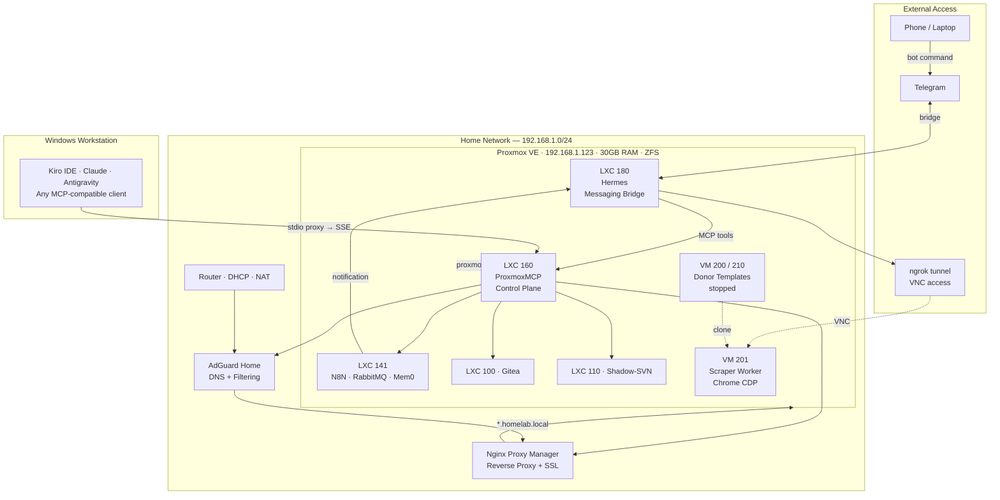

# Home Lab & AI Control Plane

> Personal Proxmox VE infrastructure — every operation is an MCP tool, every management task is a conversation.

**→ [Türkçe versiyon (ana doküman)](README.md)** | **→ [Technical Details](DETAILS_EN.md)**

---

*Custom ProxmoxMCP Web Dashboard (`:8000/dashboard`) — Built out of necessity to monitor and manage all LXC, VM, and container workloads at a glance.*

 

  
   
  <em>LXC 141 (docker-host) Container Workloads — N8N, Watchtower, Mem0 (pgvector), and 9router services.</em>

---

## How It Started: An Infrastructure Journey Born Out of Necessity

### 1. The Spark (Ad Blocking & Content Filtering)
The motivation was simple: content filtering for the kids and network-wide ad blocking for every device in the house, without configuring each one separately. There was an old PC gathering dust in a corner — instead of throwing it away, I decided to put it to use.

I installed AdGuard Home directly on the machine, no Proxmox yet. On the router, I changed the DNS address distributed via DHCP to AdGuard's IP. From that point, every phone, TV, computer, and guest's device was automatically filtered — no settings touched on any of them. This setup running on a few hundred MB of RAM was using almost none of the machine's capacity — and the rest of it sitting idle started to bother me. *"With this much capacity available, why just DNS?"* — that question was where everything began.

### 2. Developer Fatigue & The Need for a Centralized Core (Proxmox VE & ZFS Mirror)
While AdGuard was running smoothly, the pivotal catalyst that drove me to Proxmox was raw developer fatigue: I routinely shuffled work across multiple desktop PCs and laptops. Installing MSSQL Server, PostgreSQL, Docker daemon, and isolated testing virtual machines on every single machine separately — while constantly migrating database backups, syncing environment variables (`.env`), and managing configuration drift — had become a massive drain on time and focus. Laptops were buckling under the weight of local heavy databases.

The epiphany was clear: decouple heavy development workloads from client workstations and centralize them into a resilient, shared bare-metal server core. I installed Proxmox VE with dual SSDs in a ZFS mirror — guaranteeing zero data loss even in the event of hardware drive failure. Now, relational databases (MSSQL, PostgreSQL), Docker workloads, and full Windows VMs for Delphi compilation and desktop testing all lived in one isolated, high-performance node. No matter which laptop or desktop I sat down at, I connected to the identical centralized environment over the local network — drastically cutting repetitive setup effort while ensuring seamless synchronization across all workstations. As the initial milestone, I containerized AdGuard into an unprivileged LXC; officially opening the door to multi-service architecture.

### 3. Network Hygiene, IP Decoupling & DNS Resolution (AdGuard Rewrite + Nginx Proxy Manager)
As services multiplied, memorizing raw IP addresses and ports became unsustainable. More critically, whenever a container was recreated or an IP changed, hardcoded connection strings and `.env` configs across multiple laptops would break. I deployed Nginx Proxy Manager and integrated DNS rewrite rules in AdGuard. Now, regardless of underlying dynamic IPs, pointing to `adguard.homelab.local` or `proxmox.homelab.local` was seamless; local DNS resolved the hostname, and NPM routed traffic securely with internal SSL. If a container IP shifted, updating NPM in one place fixed it everywhere, completely decoupling development workflows from physical IP changes. A simple setup, but it gave the infrastructure its first sense of *"an organized home."*

### 4. Code Sovereignty & Local GitOps (Gitea)
To version-control custom tools, automation scripts, and environment configs locally without relying on external cloud registries, I deployed a self-hosted Gitea instance. This kept all code assets fully on-premise while establishing a local webhook backbone for automated GitOps deployments.

### 5. First Real Workload & Bot Bypass (N8N, Chrome CDP & RabbitMQ)
A while later I needed to monitor a website regularly. Instead of checking manually, I set up N8N and wrote a workflow. I quickly hit a wall: the site had bot protection. The solution was to behave like a real browser. I tried connecting to an existing Chrome session via DevTools Protocol — it worked. As the load grew, I needed to queue jobs; I added RabbitMQ in between and turned a separate VM into a worker. This was the old PC's first *"real workload"* test, and it passed without complaint.

### 6. Conversational Bridge in My Pocket (Hermes, Telegram & ngrok)
I wanted results delivered to Telegram — which wasn't new to me. I'd already used simple Telegram notifications in an earlier project. But as things grew, a question stuck with me: could I send commands back, not just receive notifications? While researching Telegram-based remote control options, I found Hermes. Not just Telegram — a bridge that connects Discord, Signal, Slack, and Matrix all in one place, with custom commands on top. I set it up, tested it; it worked. The messaging app was already in my pocket; why open a separate panel?

One day I needed to reach a VM from the office. The classic route was a VPN or leaving a port open permanently; both felt like unnecessary security risks. Instead, I wired up an ngrok + VNC integration: one Telegram message, and a time-limited connection URL arrived on my phone seconds later. When the session ended, the tunnel terminated cleanly without leaving any open attack surface.

### 7. Multi-Model Orchestration & Fallback (9router Gateway)
Around the same time, integrating AI models into the infrastructure highlighted another challenge: I was juggling multiple AI providers — Claude, Gemini, Groq, and several free-tier endpoints. Each had different rate limits, quotas, and distinct strengths. Manually switching when one hit its cap while trying to balance costs was becoming unsustainable. I initially wrote my own proxy. It worked for a while, but providers kept shifting their endpoint signatures and auth formats, making maintenance tedious. At that point, I discovered 9router — an open-source, MIT-licensed, OpenAI-compatible local gateway. Supporting 40+ providers with automated fallback and built-in token optimization, it solved the problem cleanly. I deployed it inside an LXC on Proxmox. Now all local tools and Hermes point to a single endpoint, while 9router handles provider routing dynamically.

### 8. Persistent Semantic Memory (Mem0 + pgvector)
There was one more friction point: every AI session started from zero. Yesterday's discussion and last week's architectural decisions vanished across sessions. Re-explaining context was both time-consuming and token-wasteful. Deploying Mem0 solved this completely: a self-hosted vector memory engine on PostgreSQL 17 + pgvector using Gemini embeddings for semantic search. Decisions and learned facts are persisted and recalled across sessions. I containerized it inside the `docker-host` LXC alongside 9router and Hermes.

### 9. The Unifying Control Plane (ProxmoxMCP)
With dozens of services, containers, and a solid AI backbone operational, managing them through separate web dashboards and SSH terminals became the final bottleneck. AI models were "blind" to the live infrastructure. Asking *"Can I unify this entire infrastructure into a single standard interface that AI agents can directly converse with and operate?"* led to **ProxmoxMCP**. Built with FastMCP and FastAPI, this control plane turned 60+ infrastructure operations (LXC/VM lifecycle, Docker workloads, AdGuard DNS rewrites, NPM proxy rules, and atomic 3-step service deployments) into standardized AI tools. Now, whether from desktop IDE agents (Antigravity, Kiro, Claude) or conversational Telegram messages (Hermes), managing the entire homelab requires nothing more than natural language.

### 10. Where It Stands Today: From Homelab to Enterprise-Ready Core
Each solution created the next need. What I have now is infrastructure designed from scratch, managed with a single Telegram message or a conversation with an AI agent. Nothing was built speculatively. And that old PC is no longer just blocking ads — it's running as the brain of the house.

And it doesn't stop at server administration; this centralized intelligence interconnects the entire living space. Running entirely on our self-sovereign Proxmox bare-metal stack without requiring external cloud subscriptions, public domains, or open ports, this architecture makes remarkable workflows possible on a daily basis — all fully operational:
- 🛡️ **Intelligent Parental Protection:** Child tablet DNS query logs are continuously audited by local AI; emerging inappropriate domains that bypass static blocklists are autonomously blocked on AdGuard with instant parent alerts on Telegram.
- 🏢 **Enterprise IT & Commercial Systems:** Hosting enterprise ERP, MES, CRM suites, and relational databases in isolated containers with branch VPNs and autonomous AI-driven IT operations.
- 🔥 **Combi Boiler & Thermostat Orchestration:** Leaving home dials heating down to economy mode; texting *"Home in 1 hour"* brings it up to comfort temperature, while open window sensors pause heating to eliminate natural gas waste.
- 🚗 **Computer Vision & License Plate Recognition:** Security cameras read family license plates to open motorized gates and set welcome lights, while unrecognized vehicles trigger instant photo verification prompts on Telegram.
- ❄️ **Cross-Brand Climate Control:** When living room sensors detect heat and presence, legacy air conditioners trigger automatically via local ESP32 bridges without vendor app silos.
- 📡 **Autonomous Network & Appliance Safeguards:** Network latency spikes on APs trigger one-tap auto-remediation; open refrigerator doors trigger urgent audible alerts to the family on Telegram.

Whether an automation needs no extra hardware (pure software logic configured conversationally) or physical interaction (requiring only standard local Wi-Fi/LAN connectivity), everything is orchestrated anywhere, anytime, with zero cloud dependency. *(Full technical breakdowns and detailed walkthroughs are expanded further below.)*

---

## Infrastructure Overview

---

## What I Can Do

### Full Control From Anywhere

From Telegram or a browser (`hermes.homelab.local`), regardless of whether I'm at home:

- Start and stop any VM or LXC
- Deploy a new service (LXC + DNS + proxy in a single step)
- Run an infrastructure health check
- Trigger an N8N workflow
- **Open a temporary ngrok VNC tunnel to any VM**

Kiro IDE, Claude Desktop, Antigravity, or any other MCP-compatible AI client connects to the same tools. Managing infrastructure conversationally is my normal workflow.

### Instant Isolated Environments

I keep pre-configured donor VMs for different OS types (Ubuntu, Windows, Android/BlissOS). One Telegram command via Hermes:

1. Donor VM is cloned
2. Started
3. ngrok tunnel opens, VNC address arrives on Telegram
4. When done, deleted — no trace left

Website testing, app trials, Docker stack experiments — each in an isolated, temporary, clean environment.

### Personal Git Server and AI-Assisted Code Changes

I keep local projects on Gitea (`git.homelab.local`). From my phone via Hermes, I can instruct an AI agent to open a branch, apply changes, run the pre-commit guard, and commit — then check the result in a cloned test VM. No desk required.

This is powered by **DelphiMCP** for Delphi projects — a purpose-built MCP server that gives AI agents actual semantic understanding of Delphi code: 5 specialized servers, 108 tools, blast radius analysis before any change, automatic UTF-8 BOM enforcement, MSBuild integration, and a Telegram approval gate before anything gets committed. The same pattern applies to any stack.

→ Details: **[DETAILS_EN.md — DelphiMCP section](DETAILS_EN.md#delphimcp-a-custom-solution-for-ai-editor-blind-spots)**

### Smart Notifications

I prefer the system alerting me over manually checking things. Active scenarios:
- **Morning infra health report** — automatic every morning; if a service is down, I know with my first coffee
- **Monitoring bot results** — instant notification when a tracked page changes
- **Operation completion** — kick off clone/backup/deploy, walk away, get a message when done
- **Third-party update tracking** — I install applications manually into LXCs or Docker containers on Proxmox and have no way of knowing when a new version is released. I tell Hermes: "check these services, notify me if there are updates, and set up a morning cron" — the agent runs `exec_in_container` to check package state, creates a scheduled N8N workflow, and a Telegram message arrives whenever an update is available
- **Any external API** — any service integration wired to N8N + Hermes takes a few minutes

### Personal Git Server

I keep local projects on Gitea. Accessible at `git.homelab.local` on the local network, or through a Hermes tunnel from outside. From my phone, I can instruct an AI agent via Hermes to make changes to a repo, then check the result in a cloned test VM — no need to be at a desk.

### Data Security and Backups

Data lives on a ZFS pool — integrity is protected at the filesystem level. Proxmox's built-in backup mechanism (`vzdump`) takes automatic snapshots of critical LXCs; backups are stored in a separate storage area (`MigrationBackup`). The snapshot system allows instant rollback before any risky change.

Credential management is fully separated from application code — a central secrets file resolved through a `SecretManager` layer with an encrypted SQLite fallback. Sensitive values are never in source code or plain-text environment variables. For teams, this pattern is straightforwardly replaceable with any open-source vault solution (HashiCorp Vault, Infisical, etc.) without changing the application layer.

---

## Service Map

| ID | Service | IP | Resources | Status |
|----|---------|-----|-----------|--------|
| LXC 100 | Gitea | 192.168.1.25 | 1c/1GB/30GB | ✅ running |
| LXC 110 | Shadow-SVN | 192.168.1.26 | 1c/1GB/20GB | ✅ running |
| LXC 120 | Nginx Proxy Manager | 192.168.1.27 | 1c/1GB/10GB | ✅ running |
| LXC 130 | AdGuard Home | 192.168.1.28 | 1c/4GB/5GB | ✅ running |
| LXC 141 | Docker Host (N8N + RabbitMQ + Mem0) | 192.168.1.141 | 4c/4GB/20GB | ✅ running |
| LXC 1xx | 9router — AI Gateway | — | — | LXC or Docker |
| LXC 160 | ProxmoxMCP — Control Plane | 192.168.1.60 | 4c/512MB/8GB | ✅ running |
| LXC 180 | Hermes — Messaging Bridge | 192.168.1.80 | 2c/4GB/8GB | ✅ running |
| VM 200 | Scraper-Donor (Ubuntu+Chrome) | — | 2c/2GB/40GB | ⏸ stopped |
| VM 201 | scraper-worker-01 | — | 2c/2GB/40GB | ✅ running |
| VM 210 | Android-Malware-Analyzer (BlissOS) | — | 2c/4GB/32GB | ⏸ stopped |

*Pulled from live Proxmox API. Total RAM usage: ~8.8 GB / 30.3 GB at idle.*

---

## Technology Stack

| Category | Technologies |
|----------|-------------|
| Hypervisor | Proxmox VE, LXC (unprivileged), KVM/QEMU |
| Storage | ZFS (local-zfs), vzdump automated backups |
| Container runtime | Docker, Docker Compose (LXC with nesting) |
| Reverse proxy | Nginx Proxy Manager |
| DNS & Filtering | AdGuard Home |
| Automation | N8N |
| Message broker | RabbitMQ |
| Version control | Gitea (Git), Shadow-SVN |
| Vector memory | Mem0, PostgreSQL 17 + pgvector |
| Messaging bridge | Hermes (Telegram / Discord / Signal / Slack / Matrix) |
| AI gateway | 9router (40+ providers, auto-fallback, token optimization) |
| Session memory | Mem0, PostgreSQL 17 + pgvector, Gemini embeddings |
| AI protocol | MCP (Model Context Protocol) — SSE + stdio proxy |
| Control plane | FastMCP + FastAPI (Python, ~46-line bootstrap) |
| Remote access | ngrok (TCP tunnel, ephemeral), VNC |
| AI clients | Kiro IDE, Claude Desktop, Antigravity — any MCP-compatible client |
| Credential management | SecretManager (ENV-first, encrypted SQLite fallback) |

---

## What Kind of Developer I Am

20 years of IT and electronics experience, professional software development since 2021, specializing in Delphi enterprise healthcare systems. This home lab shows something the CV can't: when I encounter a problem, I solve it with tools — and if the tools don't exist, I build them.

- **Systems thinking:** Every layer was designed with intent. The reasoning behind each decision is traceable.
- **Protocol-level engineering:** The MCP stdio proxy handles edge cases not covered in any documentation — diagnosed from raw JSON-RPC traffic.
- **How I work with AI:** I build tools that AI connects to as a client. Kiro, Claude, and Antigravity manage my infrastructure conversationally through the MCP server I wrote. This is my default workflow, not a demo.
- **Automation reflex:** Every component in this stack was built to replace something I was doing manually. The reflex is: see the repetition, automate it.

---

## What's Next? (Future Vision: An AI-Native Centralized Control & Customization Paradigm)

The current implementation has matured the environment into a **"conversational, command-driven"** control plane. The ultimate goal here is not merely reproducing isolated smart home recipes that off-the-shelf apps already tackle; it is presenting **a novel, AI-native architectural paradigm for centralized remote control, zero vendor lock-in, and extreme customization**.

Where traditional setups trap users behind a dozen proprietary mobile apps, clunky dashboards, and rigid static logic ("if-this-then-that"), this architecture connects all hardware, software, and network layers into a **single central neural substrate**. The system interprets human intent, audits logs autonomously to deploy protective policies, and exposes the entire physical and logical household to limitless, on-the-fly customization from a single conversational interface.

The ultimate competitive edge is the **self-sovereign Proxmox bare-metal foundation**: without needing any paid cloud host (VPS), external domain registrar, static public IP, or risky firewall port-forwarding holes, this entire ecosystem operates 100% locally and autonomously. Crucially, this is not just a consumer runtime for third-party containers — it is a **fully integrated software and deployment factory**: whenever a novel integration, API bridge, or automation is required, we can code it from scratch, compile it, provision an isolated LXC or Docker container on the fly via MCP commands, and deploy it straight into production with zero outside dependencies.

> **Core Architectural Principle (Zero Friction, Maximum Flexibility):**
> - **Software-Only & Logical Automations (No Extra Hardware Needed):** Rule evaluations, AdGuard DNS query log audits, dynamic parental filtering, API hooks, and alert dispatchers require zero additional hardware. Everything is configured and operated conversationally or via commands directly within Telegram.
> - **Physical Hardware Workloads:** Target appliances (combi boilers, HVAC units, thermostats, lighting, routers, IP cameras) only need to be connected to the local network via Wi-Fi or wired LAN and support standard command interfaces (REST API, MQTT, HTTP, ONVIF, or custom ESP32 bridges).
> - **Anywhere, Anytime Execution:** All automations and configurations can be provisioned and adjusted from anywhere in the world via Telegram — configured as scheduled routines (cron/n8n), sensor/event-triggered flows, or spontaneous, on-demand (ad-hoc) overrides.

### 1. Infrastructure & Software Reflexes
- 🛡️ **Self-Healing Infrastructure:** In the event of service degradations or memory leaks, AI agents automatically inspect logs (`docker_logs`, `exec_in_container`), diagnose the root cause, restart the degraded service, and deliver a concise resolution report to Telegram.
- 🔄 **Local GitOps Pipeline (Gitea Webhooks → Auto-Deploy):** Triggering zero-touch builds, tests, and container deployments directly on Proxmox upon every `git push` to Gitea, eliminating manual dashboard interaction.
- 🧠 **Engineering Memory & Codebase RAG:** Semantically indexing past Delphi, Python, and infrastructure codebases into Mem0 and pgvector, enabling instant recall of past architectural patterns and implementations during active development.
- 🔐 **Interactive 2FA Approvals for Critical Operations:** Requiring one-tap Telegram inline button verification (`[Approve / Reject]`) before executing destructive or high-impact MCP tool commands (`remove_resource`, backup pruning, etc.).

### 2. Commercial Ecosystems & Open Protocol Integration (No Vendor Lock-in)
Commercial smart appliances routinely trap users inside proprietary vendor silos (Philips Hue, Tuya/Smart Life, Xiaomi/Aqara, Sonoff, Samsung SmartThings, LG ThinQ). The vision bridges these disparate ecosystems via standardized open protocols (**MQTT, Zigbee2MQTT, Matter/Thread, Home Assistant**) under a unified conversational Telegram/Hermes control plane:
- **Lighting & Energy:** Unifying Philips Hue bulbs, Shelly relays, and Tuya wall switches under identical conversational primitives.
- **Climate & Heating:** Orchestrating Daikin, Mitsubishi, and Gree air conditioners; Bosch, Viessmann, Vaillant, and Buderus combi boilers; and Tado/Netatmo smart thermostats without manufacturer software constraints.
- **Network Hardware:** Integrating telemetry and control APIs across Keenetic, MikroTik, Ubiquiti UniFi, and ASUS routers/APs.

### 3. Liberating "Dumb" Appliances via Custom ESP32 Microcontrollers
For appliances lacking native smart connectivity or locked behind restrictive cloud paywalls, **custom-flashed ESP32 microcontrollers** (powered by ESPHome or Tasmota) take over:
- Equipping traditional split air conditioners with custom infrared (IR) transceivers to gain complete, cloud-independent local Wi-Fi control.
- Retrofitting traditional combi boilers with dry-contact relays or OpenTherm interface boards to build an intelligent whole-home heating system driven by affordable Zigbee/BLE temperature sensors in every room, bypassing costly proprietary thermostats.
- Retrofitting garage doors, refrigerators, and water heaters with environmental sensors (DHT22, BME280) to run intricate multi-condition automations impossible with off-the-shelf software.

### 4. Computer Vision & Vision AI Security
- **RTSP Camera Streams:** Ingesting local video feeds from Hikvision, Dahua, and Reolink security cameras into local vision models (YOLO, Frigate NVR).
- **Automated License Plate Recognition (ALPR):** Real-time vehicle plate extraction matched against user-defined allowlists and blocklists to orchestrate physical gates and perimeter alerts.

### 5. AI-Assisted Dynamic Parental Protection & Smart DNS Filtering
Connecting directly back to the project's original genesis with AdGuard Home, AI analytics elevates static blocklists into proactive, adaptive protection:
- **Static IP & MAC-Based Device Profiling:** Categorizing household hardware (children's tablets, school laptops, smart TVs, guest phones) via MAC addresses and DHCP leases into distinct AdGuard client profiles.
- **Log Auditing & Semantic Risk Analysis:** Periodically scanning DNS query logs (`adguard_status`, query logs) for emerging, newly registered, or unclassified domains that bypass static commercial blocklists.
- **Autonomous Rule Provisioning via Local LLMs:** When local models evaluate a domain as age-inappropriate, phishing, or predatory, they dynamically invoke `adguard_add_filter` and `adguard_set_custom_rules` to sever access and inform parents immediately.

### 6. From Homelab to Enterprise IT: Commercial Systems & Enterprise Backbone
While this architecture matured inside a homelab context, its container isolation, storage resilience, and AI orchestration enable it to **serve as the primary IT and systems core for any commercial enterprise or SME**:
- **Commercial Systems & Database Hosting:** Hosting mission-critical enterprise ERP, MES, CRM suites, and relational databases (SQL Server, Firebird, PostgreSQL) inside isolated unprivileged LXC and VM environments with zero recurring cloud fees.
- **Unified IT Operations & Network Security:** Orchestrating branch-to-branch VPN tunnels, enterprise DNS filtering (blocking phishing and malicious telemetry via AdGuard), SSL termination with NPM, and automated ZFS mirror snapshot policies for total business continuity.
- **Self-Hosted AI Operations Assistant:** Keeping proprietary enterprise databases, customer records, and internal codebases 100% on-premise. Local LLM routing via 9router and semantic memory in Mem0 empower AI agents to audit server logs, detect DB query anomalies, and dispatch instant diagnostic telemetry to the IT manager on Telegram.

### 7. Distributed PC Fleet Management: RabbitMQ & API-Driven Autonomous Agent (Active Development)
Currently under active development and testing across donor physical PCs and staging VMs:
- **Cross-Platform Agent Runner (Windows & Linux):** A lightweight, modular daemon running across distributed machines, following an MCP-like decoupled architecture.
- **Self-Updating via API:** The agent autonomously checks for new releases and pulls its own binary/code updates over a secure API endpoint with zero manual intervention.
- **Asynchronous & Firewall-Friendly via RabbitMQ:** Instead of requiring open inbound firewall ports on target endpoints, agents securely poll RabbitMQ message queues, ensuring guaranteed, decoupled command delivery even through network interruptions.
- **AI-Powered Remote Automation:** Enabling central AI orchestrators to remotely manage distributed PC fleets, execute automated maintenance, run end-to-end tests, and execute complex desktop automation workflows conversationally.

### 8. Real-World Walkthrough Scenarios ("For instance...")
- 🤖 **For instance (Distributed PC Fleet & RabbitMQ Autonomous Agent):** When a batch compilation, web-scraping task, or integration test is needed on a remote donor workstation, the central AI agent drops a task payload onto the target machine's RabbitMQ queue. The background agent on Windows or Linux picks up the message, executes the build/test suite, and reports diagnostic telemetry back. When agent improvements are deployed, the daemon updates itself silently over the API.
- 🏢 **For instance (SME / Enterprise IT Operations — ERP/MES, Databases & Security):** Deployed as an enterprise core server, the stack isolates the company's production ERP/MES databases and internal B2B endpoints on bare metal. The AI agent audits nightly ZFS snapshot integrity, monitors connection logs, and immediately alerts the IT lead on Telegram if unauthorized off-hours access or suspicious DNS exfiltration is detected: *"Suspicious off-hours connection attempt blocked on Accounting Database. Terminate session? [Terminate / Inspect]"*.
- 🛡️ **For instance (AdGuard + Static IP/MAC + AI Child Protection):** DNS queries from a child's dedicated tablet (identified by MAC address) are periodically audited in the background by the AI agent. When an unlisted gaming or pop-under domain (e.g., `game-reward-xyz.net`) surfaces that standard blocklists miss, the AI model identifies predatory data-collection patterns, dynamically injects a custom block rule into AdGuard, and pings parents on Telegram: *"Suspicious domain queried on Child's Tablet. Age-inappropriate redirect detected; domain autonomously blocked on AdGuard. [Unblock / Review]"*.
- 🔥 **For instance (Combi Boiler & Smart Thermostat — Bosch/Vaillant + ESP32):** In winter, when you leave the house (phones disconnect from UniFi/AdGuard Wi-Fi), the boiler automatically drops to economy setpoint (18.5°C). Before heading home, messaging *"Home in 1 hour"* on Telegram triggers the ESP32 dry-contact bridge to warm the house to a comfortable 22°C. Overnight, the temperature dials back to 20.5°C. If a living room window contact sensor detects an open window, boiler firing pauses immediately with a Telegram alert: *"Living room window open, heating paused"*, cutting natural gas waste by 20-30% without sacrificing comfort.
- 🚗 **For instance (Hikvision/Dahua Camera + Smart Gate + Telegram):** As you arrive home in the evening, the security camera scans your vehicle's plate (e.g., `34 ABC 123`); a Shelly relay triggers the motorized driveway gate, Philips Hue exterior lights shift to a warm welcome scene, and Telegram pings *"Welcome home."* If an unrecognized vehicle parks at the perimeter, the gate stays locked and an instant snapshot is dispatched to Telegram: *"Unrecognized vehicle detected. Open gate? [Yes / No]"*.
- ❄️ **For instance (Daikin/Mitsubishi HVAC + Aqara Sensors + ESP32):** A cross-brand rule impossible within vendor apps: if an Aqara living room sensor registers >27°C, room motion is confirmed, and your phone is authenticated on the home Wi-Fi via UniFi/AdGuard, a custom ESP32 IR bridge powers on the legacy air conditioner in eco dehumidify mode. When you leave the house, the unit powers down automatically to eliminate waste.
- 📡 **For instance (Keenetic / UniFi Router Autonomous Health):** When a living room UniFi Access Point or Keenetic gateway experiences abnormal packet loss or latency spikes, Hermes messages on Telegram: *"Elevated latency detected on Living Room AP. Optimize channel or reboot? [Optimize / Reboot]"*, resolving the issue with a single tap via device API.
- 🧊 **For instance (Samsung/Bosch Appliances & Asset Protection):** If a refrigerator door sensor remains unsealed for over 3 minutes or compressor energy consumption spikes abnormally, a high-priority audible alert is immediately dispatched to the entire family on Telegram, bypassing silent manufacturer app notifications.

---

## Portability: Continue from Any Machine

The MyEnv repository lives on Gitea. Moving to a new machine: `git clone` + fill in the `.template` files. The `.agents/` folder carries all AI behavior rules, workflow definitions, and standards — Kiro or Claude immediately continues with the same mindset. The Proxmox server stays separate; services keep running without interruption. Cross-session memory is stored in Mem0 — context doesn't disappear when the PC changes.

### Centralized Secrets & Vault Architecture: Single Source of Truth

No component in the infrastructure (application code, bots, scripts) hardcodes passwords or API tokens:
- **Single Source of Truth:** All credentials are consolidated in one centralized vault: Master-Credentials.env.
- **Multi-Tier Consumption:** ProxmoxMCP (SecretManager), Docker containers (env_file), LXC services, and Windows proxies all consume from this single source.
- **Zero Leakage & Portability:** Excluded via .gitignore — credentials never touch Git history. Transitioning to a new PC only requires filling in Master-Credentials.env.template. The backend storage layer can be transparently swapped with HashiCorp Vault or Infisical without altering application code.env`. ProxmoxMCP, Docker containers, LXC services, and Windows proxies all read from the same source. Never enters the repo — carried via `.template`.

→ Full technical details, MCP tool catalog, diagrams, and use case walkthroughs: **[DETAILS_EN.md](DETAILS_EN.md)**

---

*Cihad Kocaşahan — [github.com/cihadkocasahan](https://github.com/cihadkocasahan) — [linkedin.com/in/cihadkocasahan](https://linkedin.com/in/cihadkocasahan)*
